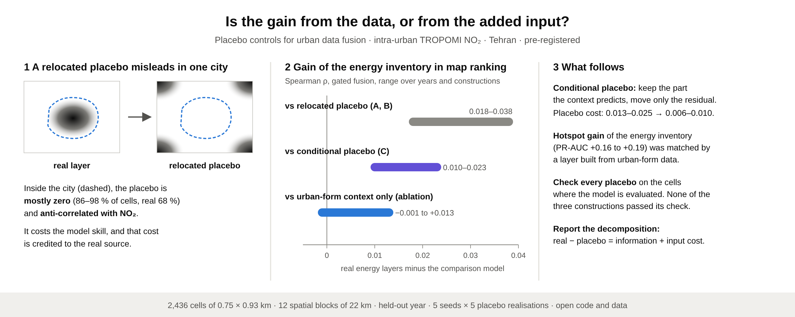
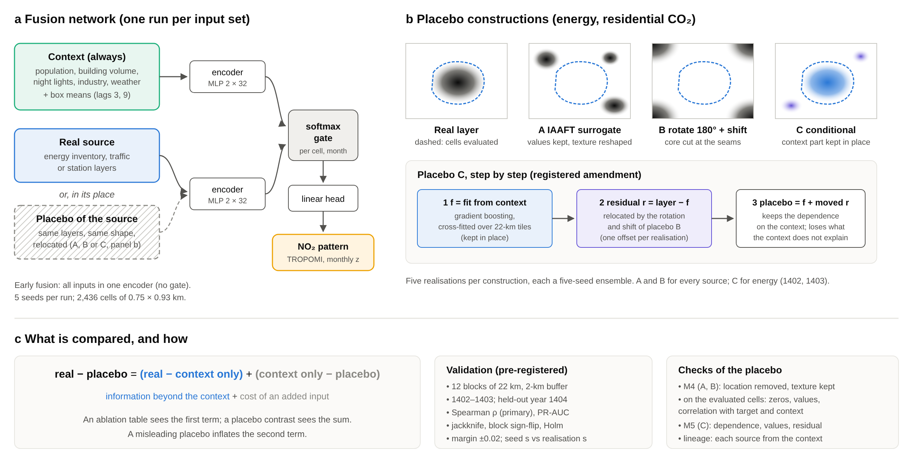
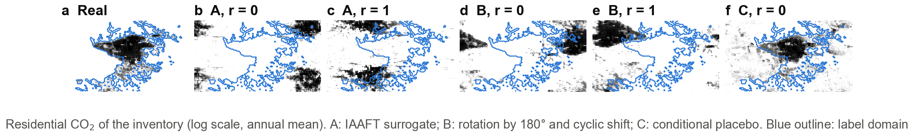
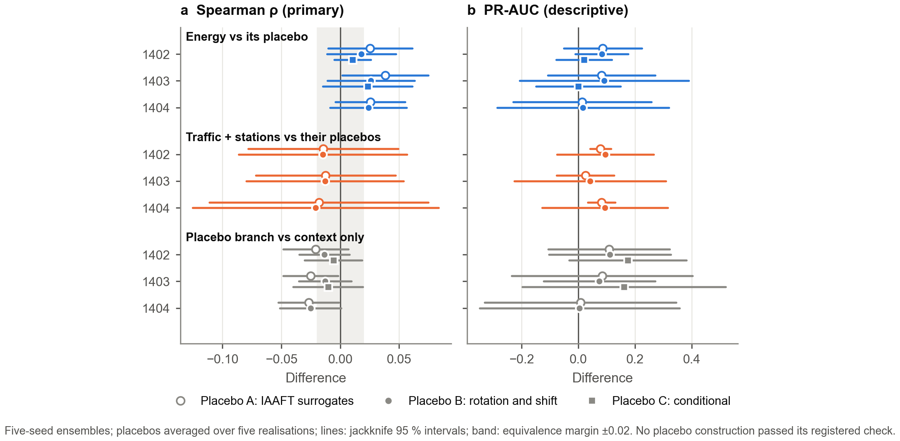
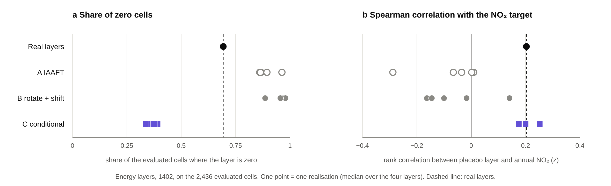
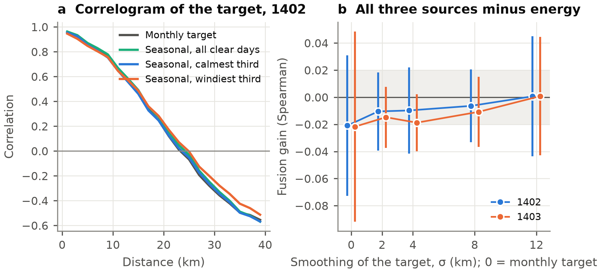

# Relocated placebo inputs inflate the value of urban data in fusion models: a conditional placebo test with satellite NO₂ in Tehran

**Fatemeh Vafaeian¹, Vahid Khatibi¹\***

¹ [Affiliation to be completed]  
\* Corresponding author: [e-mail to be completed]

*Draft manuscript, 15 November 2026. Every number comes from the runs on branch `paper_fusion` of the project repository
(`docs/paper/fusion_paper/results_*`, `results/fusion_review`, `results/fusion_amend`). Items in [brackets] are to be
completed before submission. The internal reviews and the responses to them are in `docs/paper/fusion_paper/review/`.*

---

## Highlights

- Source ablation mixes a source's information with the effect of adding an input.
- Placebo branches: the same layers, relocated, trained in the same fusion network.
- In a single-city map, relocated placebos were mostly zero and anti-correlated.
- Their cost to the model made up most of the energy data's apparent advantage.
- A conditional placebo cut that cost (0.006–0.010) and matched energy's hotspot gain.

---

## Graphical abstract

---

## Abstract

Urban data fusion models are usually judged by ablation: a data source is added to a multi-branch network and the change
in skill is credited to it. Adding a source, however, also adds an input, parameters and a competitor for the fusion
weights. A placebo branch, the same layers moved to a random place and trained in the same network, can separate these
effects, but what a spatial placebo must preserve to be a fair control has not been examined. We tested three placebo
constructions in a pre-registered study that maps the intra-urban pattern of monthly TROPOMI NO₂ over Tehran (2,436
cells of 0.75 × 0.93 km) from energy-inventory, traffic and station data with urban-form context, with 22-km spatial
blocks, a held-out year, five seeds and five realisations per placebo. Energy layers beat relocated placebos (IAAFT
surrogates; rotation and shift) by 0.018–0.038 in Spearman correlation, yet beat the context alone by only −0.001 to
+0.013. Inside a single city, the relocated layers were mostly zero (86–98 % of the evaluated cells, against 68 %) and
weakly anti-correlated with NO₂, and adding them cost 0.013–0.027. A conditional placebo, registered as an amendment,
keeps the part of each layer that the context predicts and relocates only the residual. It cut the cost to 0.006–0.010
and the energy advantage to 0.010–0.023, and it reproduced the whole hotspot (PR-AUC) gain of the energy layers. No
construction passed its registered quality check; the conditional placebo lost the exact zeros of sparse layers. Placebo
controls for spatial data fusion must keep a source's dependence on the other inputs and be checked on the cells where
the model is evaluated. The emission inventory added little beyond the urban form from which it is allocated.

**Keywords:** data fusion; multimodal learning; ablation; placebo control; conditional permutation; spatial null model;
TROPOMI; NO₂; urban emissions; spatial cross-validation

---

## 1. Introduction

Urban data fusion promises sharper maps of emissions and air quality by combining sources that see the city
differently: traffic models, emission inventories, monitoring stations, imagery and points of interest (Zheng, 2015;
Baltrušaitis et al., 2019). Satellite NO₂ is a natural target for such models, because it traces combustion and is
observed everywhere (Beirle et al., 2019; Goldberg et al., 2024). The usual architecture gives each source its own branch
and lets a fusion layer weigh the branches. Examples are carbon-emission mapping (Zeng et al., 2025) and, beyond the
city, crop-yield prediction (Mena et al., 2025).

How much a source contributes is almost always judged by **ablation**: the network is trained with and without the
source, and the difference in skill is credited to the source. This credit is not clean. Adding a source also adds
input columns, parameters and, in gated or attention-based fusion, a competitor for the fusion weights. Machine-learning
studies give three reasons to expect this to matter:
- multimodal networks can be worse than their best single branch because they overfit (Wang et al., 2020);
- modalities compete during training (Huang et al., 2022);
- cross-modal effects credited to a model are often absent (Hessel & Lee, 2020).

When the target holds few independent units, as the map of a single city does, the effect of adding any input can be as
large as the information effect being measured.

A **placebo control** addresses this. The model with a source is compared not with a model without it, but with a model
that receives an input of the same form that carries no information about the target. Several fields use this idea
(Table 1). Two lines of work come closest to our setting:
- spatial null models, which keep the texture of a map but move it (Harms et al., 2001; Wagner & Dray, 2015; Ridder et
  al., 2024);
- retraining with a randomised or conditionally resampled input (Mentch & Hooker, 2016; Hooker et al., 2021; Bernett et
  al., 2026).

Neither has been used to judge a source in a spatial fusion network. Neither asks what a spatial placebo must preserve
when the map holds one city.

**Table 1.** Controls for the value of an input, and what each keeps of the input it replaces. "–": not applicable.

| Control | Example | Model refitted | Spatial texture kept | Dependence on the other inputs kept |
|---|---|---|---|---|
| Ablation (drop and refit) | common practice | yes | – | – |
| Permutation of a modality at test time | Gat et al. (2021) | no | no | no |
| Permute and relearn | Mentch & Hooker (2016) | yes | no | no |
| Shadow features | Kursa & Rudnicki (2010) | yes | no | no |
| Knockoffs; condition and relearn | Candès et al. (2018); Hooker et al. (2021) | yes | no | yes |
| Spatial null maps (torus shift, spin, spectral surrogates) | Harms et al. (2001); Alexander-Bloch et al. (2018); Wagner & Dray (2015) | – (tests between maps) | yes | no |
| Shift-and-rotate null predictors | Ridder et al. (2024) | yes | yes | – (all predictors replaced) |
| Randomised modality, retrained | Bernett et al. (2026); Georgiou et al. (2026) | yes | – | no |
| Relocated placebo branch (A, B) | this study | yes | yes | no |
| Conditional spatial placebo (C) | this study | yes | yes (residual) | yes (conditional mean) |

**What a spatial placebo must preserve.** A placebo is a fair comparison only if the network cannot tell it from the real
source except through information about the target. A relocated layer keeps the values and texture of the source on the
whole grid. The model, however, is trained and evaluated on the cells of the city. In a bounded grid with one urban
core, moving a layer moves the city's values out of the evaluated cells and moves the empty surroundings in. Relocation
also breaks the dependence of the source on the other inputs, and urban sources are largely derived from the same
urban-form layers that every model receives. The placebo may then be not an empty input but a misleading one, and its
cost would be credited to the real source.

**This study.** We test this in Tehran, where a companion study found that fusing traffic, energy and station data did
not beat the best single source (Vafaeian & Khatibi, in review). We compare each source with three placebos, in a
design registered before any run, and ask four questions:
1. **Information.** Does a source beat its placebo?
2. **Added input.** How large is the effect of adding a placebo, compared with the effect of a real source?
3. **Target support** (secondary). Does the value of fusion change when the satellite target is sharper (calm days) or
   coarser (smoothed)?
4. **Placebo construction.** Does a relocated placebo behave as an empty input in the map of a single city, and does a
   placebo conditioned on the other inputs behave better?

Question 4 arose from the results of the first two. Its test was registered as an amendment before it was run.

**Contributions.**
1. **Placebo branches for spatial data fusion.** We state three requirements that a placebo must meet (Section 3.2) and
   give a reporting identity (Eq. 1). The identity splits any placebo contrast into the gain over a reference model and
   the cost of the placebo input.
2. **Evidence that relocated placebos violate these requirements on the evaluated cells of a single-city map.** They
   become zero-inflated and anti-correlated with the target, and their cost made up most of the apparent advantage of
   real data (Sections 4.2–4.3).
3. **A conditional spatial placebo**, a retrained spatial form of condition-and-relearn (Hooker et al., 2021), that
   keeps a source's dependence on the other inputs. It cut the placebo cost by more than half on average. It also showed
   that the hotspot gain of an emission inventory was reproduced by a layer built mainly from urban form (Section 4.4).
4. **A pre-registered test reported in full**, failed checks included, with open code and results.

## 2. Study area and data

### 2.1 Grid, years and target

The grid covers 50.85–51.90°E and 35.35–35.95°N with 72 × 126 cells of 1/120°, about 0.75 × 0.93 km. The model is
trained and evaluated on a **label domain** of 2,436 cells. These are the cells of the three central counties (Tehran,
Rey and Shemiranat) to which the emission inventory assigns any CO₂. We use three Iranian (Solar Hijri) years:
- 1402 (March 2023 – March 2024) and 1403, for development;
- 1404 (March 2025 – March 2026), held out.

The target is the monthly mean tropospheric NO₂ column of the TROPOMI offline level-3 product in Google Earth Engine
(`COPERNICUS/S5P/OFFL/L3_NO2`), averaged on the grid. Non-positive values are set to 10⁻⁷ mol m⁻² before the logarithm.
The log column is then standardised over the domain in each month (z), so that only the spatial pattern is kept.

The TROPOMI footprint (3.5 × 5.5 km at nadir) is coarser than the grid, and the target is smooth. Its correlogram
crosses zero at about 24 km. Its effective number of independent cells is about five per month, computed as
n² / Σᵢⱼ ρ(dᵢⱼ) from the truncated correlogram (Griffith, 2005; Vafaeian & Khatibi, in review).

### 2.2 Data sources and their shared lineage

**Table 2.** Data sources. Every spatial layer enters with its value in the cell and with its means over square windows
of half-width 3 and 9 cells (up to about 7.6 km).

| Source | Layers | Inputs per cell |
|---|---|---|
| Energy | residential, commercial, industrial and power-sector CO₂ of a bottom-up inventory; monthly heating degree-days | 13 |
| Traffic | road-transport CO₂ of the same inventory; road length in four classes; peak-hour vehicle-kilometres and volume-to-capacity ratio of a traffic assignment | 21 |
| Stations | CO of the municipal monitoring network, interpolated by inverse distance | 3 |
| Context (always present) | GHSL population, total and non-residential building volume, VIIRS night lights, industrial land share, ERA5 temperature and wind | 17 |

The station layer uses CO, the only pollutant measured in both years that is not the target species. It is rebuilt for
every fold without the stations within 2 km of the test block, which avoids pre-processing leakage (Kapoor &
Narayanan, 2023). For 1404 the inventory and traffic layers of 1403 stand in, so the held-out year tests transfer to a
new target year, not to new source data.

**The sources are not independent.**
- The residential and commercial CO₂ of the inventory is allocated in proportion to GHSL residential and
  non-residential building volume, and industrial CO₂ by OSM industrial area. The context contains these same layers.
- The trips of the traffic model are distributed by population and non-residential volume.
- The station layer is a smooth interpolation of a few points.

Emission inventories inherit the spatial pattern of their allocation proxies (Geng et al., 2017; Gately & Hutyra, 2017;
Mu et al., 2022). Here the proxies are also given to the model as a source of their own. This lineage is what makes the
choice of placebo matter.

## 3. Methods

Fig. 1 summarises the design.

**Fig. 1.** Study design. (a) The fusion network: context is always a branch, and a real source or its placebo is a
second branch, combined by a softmax gate (gated fusion) or concatenated (early fusion). (b) The three placebo
constructions, sketched on the residential CO₂ layer (schematic, not data): A, IAAFT surrogate; B, rotation by 180° and
cyclic shift; C, conditional placebo, in which the part predicted by the context is kept and the residual is relocated.
The dashed outline marks the cells where the model is evaluated. (c) What is compared: the contrast of a real source
with its placebo splits into the gain over the context and the cost of an added input (Eq. 1); validation design and
checks of the placebo.

### 3.1 Fusion network

Every model is the graph-free fusion network of the companion study.
- **Encoders.** Every source, the context included, has its own encoder: a two-layer MLP with 32 hidden units and
  dropout 0.1.
- **Fusion.** In gated fusion, a softmax gate weighs the encoders for every cell and month (Arevalo et al., 2017). In
  early fusion, all inputs are concatenated into one encoder.
- **Head.** A linear head predicts z.
- **Training.** AdamW (learning rate 3 × 10⁻³, weight decay 10⁻⁴), 300 epochs, mean squared error. All
  hyper-parameters were fixed before this study.
- **Seeds.** Every model is the mean of five seeds.

A model "with energy" therefore has two branches (context and energy), and the context-only model has one.

### 3.2 What a placebo must preserve

A placebo of a source S is meant to answer one question: does S help because of what it says about the target, or
because the network received one more input? For the comparison to answer that question, the placebo should meet three
requirements:
- **R1 – no extra information.** It carries no information about the target beyond what the other inputs carry.
- **R2 – same appearance.** It looks like S to the network: the same distribution of values on the evaluated cells,
  zeros included, and the same spatial texture.
- **R3 – same dependence.** It has the same dependence on the other inputs as S.

If R1–R3 hold, the real-minus-placebo contrast measures the information of S beyond the other inputs, at equal model
capacity. If R2 or R3 fails, the placebo is a different kind of input. The contrast then also measures how the network
copes with that input.

### 3.3 A reporting identity

Let ρ(·) be the skill of a model, here the Spearman correlation of its map with the target. For a source with placebo P,

$$\underbrace{\rho(\text{real})-\rho(P)}_{\text{placebo contrast}} \;=\; \underbrace{\rho(\text{real})-\rho(\text{context})}_{\text{ablation}} \;+\; \underbrace{\rho(\text{context})-\rho(P)}_{\text{cost of the placebo input}} \qquad (1)$$

Eq. (1) is algebra, not a new estimator. Its use is in reporting both terms.
- An ablation table shows the first term only.
- A placebo contrast shows the sum.
- The second term tells whether a placebo contrast reflects the source or the placebo. If the placebo meets R1–R3, that
  term is the effect of adding an input that carries no new information.

### 3.4 Three placebo constructions

**Placebo A: IAAFT surrogates** (registered first). Each layer's annual map is mirror-padded to twice its size, so that
it is periodic without edge jumps. Multivariate IAAFT surrogates are generated (Schreiber & Schmitz, 1996; Prichard &
Theiler, 1994):
- one random phase field is shared by the layers of a source, so that their cross-spectra are kept;
- 100 iterations alternate between restoring the amplitude spectrum and restoring the exact values by rank.

The original window is then cut out and its values set by rank to the real values.

**Placebo B: rotation and cyclic shift** (registered fallback). Every layer of a source is rotated by 180° and shifted
cyclically. One random offset, of a quarter to three quarters of the grid in each direction, applies to all months,
years and layers of a realisation. B keeps the values, the monthly cycle and the correlation between the layers of a
source exactly, and it keeps the texture everywhere except at the wrap-around seams.

A and B aim at R1 and at the texture part of R2. They make no attempt at R3.

**Placebo C: conditional placebo** (registered amendment). C keeps the part of a layer that the context explains and
relocates only the rest:

$$\tilde X \;=\; \hat f(\mathbf{Z}) \;+\; T\!\left[X-\hat f(\mathbf{Z})\right] \qquad (2)$$

- X is the annual map of a layer (log1p where the dataset uses it).
- **Z** is the context: its layers and their box means at lags 3 and 9.
- f̂ is gradient boosting with the settings of the lineage audit (Section 4.3).
  - f̂ is cross-fitted over five random groups of 22-km tiles of the whole grid, so that no cell is predicted by a
    model that saw it.
- T is the rotation and shift of placebo B for the same realisation.
- The result is back-transformed, clipped at zero and given the city-wide monthly cycle of the layer.

C is a spatial form of condition-and-relearn (Hooker et al., 2021) and of residual permutation of a predictor (ter
Braak, 2022; Huang, 2025). It aims at R1 and R3. It keeps the conditional mean of a layer given the context, not its
full conditional distribution. It was built for the energy source.

**For all constructions:**
- City-wide layers (degree-days) are copied, so that a placebo branch has as many inputs as the real branch.
- A placebo stays in place across years, as real static layers do.
- We use five realisations per construction. Every placebo score is the mean over the five realisations, also inside
  the jackknife and the randomisation test.
- The station placebo is built from the all-station layer. The relocation removes any information on the test block.

**Fig. 2.** The residential CO₂ layer of the inventory and its placebos (log scale, annual mean; one grey scale for all
panels; white = zero). (a) Real layer. (b, c) Placebo A, IAAFT surrogates, realisations 0 and 1. (d, e) Placebo B,
rotation by 180° and cyclic shift, realisations 0 and 1. (f) Placebo C, conditional, realisation 0: the urban core stays
in place, and small non-zero values appear where the real layer is zero. Blue outline: label domain.

### 3.5 Validation, metrics and inference

**Validation.** The label domain is divided into 12 blocks of 22 km. Each block is held out once, and training cells
within 2 km of it are removed (Roberts et al., 2017). For 1404, every fold trains on the training blocks of 1402 and
1403 and predicts the held-out block of 1404 (Meyer et al., 2018). The 2-km buffer is short compared with the 24-km
correlation length. Absolute skill therefore includes interpolation within the city; every comparison shares the same
folds.

**Metrics.**
- **Primary: Spearman correlation** between predicted and observed z over the domain, averaged over months.
- **Descriptive: PR-AUC** of the monthly top 10 % of cells (hotspots), computed as average precision and averaged over
  months (chance level 0.10). Hotspots form a few connected areas, so this metric rests on very few independent units.

**Inference.** Two models are compared on identical out-of-fold predictions.
- **Interval.** A delete-one-block jackknife with K − 1 degrees of freedom gives an interval for the difference.
- **Randomisation test.** An exact block sign-flip test (2¹² assignments) gives a one-sided p-value. The predictions
  of the two models are rank-normalised within each month, swapped block by block, and the difference is recomputed.
- **Verdict.** A five-way verdict with a margin δ = 0.02 is read from the jackknife intervals (Lakens, 2017):
  - superior: the 95 % interval lies above 0;
  - equivalent: the 90 % interval lies inside ±δ;
  - non-inferior: the 95 % lower bound lies above −δ;
  - inferior: the 95 % interval lies below 0;
  - inconclusive: otherwise.
- **Multiplicity.** P-values are Holm-adjusted within each registered family (Holm, 1979).

Two caveats apply. Neighbouring blocks are dependent, because the target decorrelates over about the width of a block,
so the inference is approximate. In a null calibration of the companion study, the sign-flip test was liberal for
Spearman (5 of 20 null comparisons below 0.05).

For seed-level consistency, seed s of the real model is compared with realisation s of the placebo. These counts show
consistency and are not independent replications.

### 3.6 Registration, amendment and deviations

**Registration.** The protocol was registered in the public repository before any run (commit `9e28ddc`,
13 November 2026; `docs/paper/fusion_paper/preregistration_fusion_v1.md`) [to be deposited on OSF]. It was written after
the companion study on the same data, network and target, so its expected directions were informed by that study.

**Amendment 1.** Placebo C, its check M5 and the family G were registered on 14 November 2026 (commit `4859332`), after
the review analyses and before any of their runs. The three amendment experiments ran on one laptop CPU; the other
experiments ran on a GPU server. The first evaluation run of the amendment stopped at a coding error, because family G
was not yet treated as confirmatory. The fix changed no analysis, and the failed run is kept.

Table 3 lists every registered test and check, the expected direction written before the runs, and the outcome.

**Table 3.** Registered tests and checks. Families F and C use placebos A and B, with Holm adjustment within each family
and construction; family G uses placebo C.

| Label | Question | Registered expectation | Outcome |
|---|---|---|---|
| M4 | Do A and B remove the location and keep the texture (full grid)? | – | failed: 0 of 5 realisations for A and for B |
| F1, C1 | Energy vs relocated placebo (1402–1403; 1404) | equivalent or inconclusive | non-inferior in 6 of 6; superior by its interval once, not after Holm |
| F2, C2 | Traffic + stations vs relocated placebos, energy present | equivalent or inferior | inconclusive in 6 of 6; negative in all 30 seed pairs |
| M1–M3 | Are the wind composites valid targets, and are calm composites sharper? | – | M1 and M3 passed; M2 failed |
| F3 | Fusion gain, calm minus windy composites | positive, probably inconclusive | uninformative (M2 failed); removed from family F |
| F4 | Relative fusion gain, native minus 8-km target | positive | −0.180, inconclusive (opposite sign) |
| M5 | Does C keep dependence and values and relocate the residual? | – | failed: 0 of 5 realisations |
| G1 | Energy vs conditional placebo (1402, 1403) | equivalent or inconclusive | non-inferior in 2 of 2 |
| K1 | Conditional placebo − context only (secondary) | within ±0.02 and smaller than the cost of placebo B | −0.006 and −0.010, as expected |

By the registered rules, the verdicts of families F and C carry the label "placebo check failed", and those of family
G the label "conditional placebo check failed".

**Not registered.**
- Placebo B also failed M4. Reporting A and B side by side is a post-hoc decision.
- In F4, edge blocks with a reference Spearman of 1 left the sign-flip test.
- The following were requested in review: the spread over placebo realisations, the check of the placebos on the
  evaluated cells, the absolute-skill table and the baselines without training.

### 3.7 Secondary question: target support

**Why the target scale matters.** Correlations rise as data are aggregated (Gehlke & Biehl, 1934). The support of the
target changes both model skill and predictor importance (Gotway & Young, 2002; Moudrý et al., 2023). In Tehran, the
road and building emission layers correlate at 0.58 in single cells but at 0.998 once smoothed over 8 km (Vafaeian &
Khatibi, in review). Sources can therefore only differ in value where the target resolves their difference. We
registered two tests of this: a sharper target, built from calm-day composites, and coarser targets, built by smoothing.

**Wind composites.** The daily TROPOMI fields (cloud fraction < 0.3) of each season were ranked by the city-mean
ERA5-Land wind speed at 10 UTC.
- Calm composite: the mean of the calmest third of the clear days.
- Windy composite: the windiest third, the same number of days.
- All-day composite: every clear day.
- Each third held 15–29 days. Each composite was placed on the middle month of its season.

**Smoothed targets.** The monthly target was smoothed with Gaussian kernels of σ = 2, 4, 8 and 12 km and standardised
again. The training labels of every fold were smoothed over that fold's training cells only, so that no value of a test
block or its buffer entered a training label.

**Fusion gain.** It is Spearman(all three sources, gated) − Spearman(energy, gated).

## 4. Results

### 4.1 The level of skill

**Table 4.** Absolute out-of-fold skill. Five-seed ensembles; placebo models averaged over five realisations. The
baselines without training were computed for the development years
(`results/fusion_review/fusion_review_absolute.csv`).

| Model | ρ 1402 | ρ 1403 | ρ 1404 | PR-AUC 1402 | PR-AUC 1403 | PR-AUC 1404 |
|---|---|---|---|---|---|---|
| *Baselines without training* | | | | | | |
| Minus distance to the population-weighted centre | 0.610 | 0.645 | – | 0.167 | 0.170 | – |
| Best single context layer: night lights, box mean (lag 3) | 0.701 | 0.719 | – | 0.637 | 0.668 | – |
| IDW of the target (companion study) | 0.678 | 0.689 | – | 0.341 | 0.374 | – |
| GP on coordinates (companion study) | 0.861 | 0.808 | – | 0.718 | 0.610 | – |
| *Fusion networks (GPU)* | | | | | | |
| Context only | 0.914 | 0.914 | 0.912 | 0.576 | 0.592 | 0.637 |
| Context + placebo energy, gated, A / B | 0.893 / 0.901 | 0.889 / 0.901 | 0.886 / 0.887 | 0.684 / 0.688 | 0.675 / 0.666 | 0.644 / 0.642 |
| Context + energy, gated | 0.918 | 0.927 | 0.911 | 0.770 | 0.757 | 0.658 |
| Context + placebo energy, early, A / B | 0.895 / 0.902 | 0.891 / 0.899 | – | 0.625 / 0.672 | 0.681 / 0.686 | – |
| Context + energy, early | 0.923 | 0.928 | – | 0.621 | 0.676 | – |
| Context + energy + placebo traffic and stations, gated, A / B | 0.912 / 0.912 | 0.918 / 0.918 | 0.901 / 0.904 | 0.714 / 0.696 | 0.772 / 0.755 | 0.686 / 0.675 |
| Context + energy + traffic + stations, gated | 0.898 | 0.906 | 0.883 | 0.792 | 0.797 | 0.769 |
| *Amendment 1 (laptop CPU)* | | | | | | |
| Context only | 0.914 | 0.914 | – | 0.577 | 0.592 | – |
| Context + conditional placebo energy (C), gated | 0.908 | 0.904 | – | 0.751 | 0.753 | – |
| Context + energy, gated | 0.919 | 0.927 | – | 0.771 | 0.753 | – |

**Common level.** Every fusion network ranked the cells with Spearman 0.88–0.93. The context-only network already
reached 0.91, above a Gaussian process on the coordinates (0.81–0.86). The comparisons that follow are therefore
differences of a few hundredths on top of a high common level.

**Baselines.** Distance to the centre ranked the cells reasonably (0.61–0.65) but found almost no hotspots. Night lights
alone found hotspots better than the context-only network did (PR-AUC 0.64–0.67 against 0.58–0.59). Night lights was
chosen as the best context layer on the same data, so this baseline is slightly optimistic.

**Reproducibility.** The CPU re-runs of the context-only and energy models reproduced the GPU runs to within 0.001 in
Spearman and 0.004 in PR-AUC.

### 4.2 Ablation and relocated placebos tell different stories

**Table 5.** Real source minus relocated placebo, gated fusion. Spearman; Δ with jackknife 95 % interval; seed pairs with
Δ > 0; verdict; one-sided sign-flip p after Holm adjustment. All rows carry the label "placebo check failed".

| Test | Comparison | Year | Placebo | Δ (95 % interval) | Seeds > 0 | Verdict | p (Holm) |
|---|---|---|---|---|---|---|---|
| F1 | energy vs placebo energy | 1402 | A | +0.025 (−0.010, +0.061) | 4 / 5 | non-inferior | 0.10 |
| | | | B | +0.018 (−0.011, +0.047) | 4 / 5 | non-inferior | 0.20 |
| F1 | | 1403 | A | +0.038 (+0.002, +0.075) | 5 / 5 | superior, not significant after Holm | 0.056 |
| | | | B | +0.026 (−0.011, +0.063) | 5 / 5 | non-inferior | 0.037 |
| C1 | | 1404 | A | +0.025 (−0.004, +0.055) | 4 / 5 | non-inferior | 0.082 |
| | | | B | +0.024 (−0.009, +0.056) | 4 / 5 | non-inferior | 0.030 |
| F2 | traffic + stations vs their placebos, energy present | 1402 | A | −0.014 (−0.078, +0.049) | 0 / 5 | inconclusive | 1.0 |
| | | | B | −0.015 (−0.086, +0.057) | 0 / 5 | inconclusive | 1.0 |
| F2 | | 1403 | A | −0.012 (−0.072, +0.047) | 0 / 5 | inconclusive | 1.0 |
| | | | B | −0.013 (−0.080, +0.054) | 0 / 5 | inconclusive | 1.0 |
| C2 | | 1404 | A | −0.018 (−0.111, +0.075) | 0 / 5 | inconclusive | 0.68 |
| | | | B | −0.021 (−0.125, +0.084) | 0 / 5 | inconclusive | 0.71 |

**Energy against relocated placebos.** Taken alone, the placebo test looks like modest evidence for the energy
inventory. Energy beat its relocated placebo in every year and with both constructions, by 0.018–0.038 and in 26 of 30
seed pairs. The verdicts are non-inferior; one interval (1403, A) excludes zero, but that comparison is not significant
after Holm adjustment. The same comparisons with placebo B fall below 0.05 in 1403 and 1404, with the caveat that the
test is liberal.

**Ablation tells a different story.** Over the context alone, energy gained only +0.004, +0.013 and −0.001. Eq. (1)
shows where the difference comes from (Table 6).

**Table 6.** The energy contrast split by Eq. (1). Gated fusion, Spearman.

| Year | Ablation: energy − context | Placebo cost: context − placebo, A / B | Placebo contrast: energy − placebo, A / B |
|---|---|---|---|
| 1402 | +0.004 | +0.021 / +0.014 | +0.025 / +0.018 |
| 1403 | +0.013 | +0.025 / +0.013 | +0.038 / +0.026 |
| 1404 | −0.001 | +0.027 / +0.025 | +0.025 / +0.024 |

In every year and with both constructions, most of the placebo contrast is the cost of the placebo input.
- **Not specific to the gate.** The cost appears in early fusion as well: 0.019 and 0.023 (A), 0.012 and 0.015 (B).
- **Its size.** It matches or exceeds the gain of the real energy layers over the context.
- **Hotspots.** In PR-AUC, the relocated placebos *raised* skill over the context by 0.05–0.11 in the development
  years. A relocated copy of the energy layers thus gave about half of the +0.17 to +0.19 that ablation credits to the
  real layers.

**Spread over realisations.** Each placebo realisation is itself a five-seed ensemble.
- In Spearman, the real-energy model scored above all five realisations in all six comparisons (three years, two
  constructions), by 0.001–0.019 over the best realisation. Under exchangeability, rank 1 of 6 has a probability of
  1/6 in a single comparison.
- In 1404, two realisations differed by up to 0.040 (A) and 0.029 (B), against a real-minus-placebo difference of 0.025
  and 0.024 (`results/fusion_review/fusion_review_null.csv`).
- In PR-AUC, the realisations spread widely: from 0.52 to 0.85 for placebo A in 1403.

**Fig. 3.** Estimates of information and of the cost of an added input, in Spearman correlation (a, primary) and
PR-AUC (b, descriptive), for 1402, 1403 and the held-out year 1404. Blue: energy minus its placebo. Orange: traffic and
stations minus their placebos, energy present. Grey: placebo-energy model minus the context-only model, the cost of an
added placebo input. Open circles: placebo A; filled circles: placebo B; squares: placebo C (energy and grey rows,
1402–1403, CPU runs). Lines: jackknife 95 % intervals; band: equivalence margin ±0.02. No placebo construction passed
its check.

### 4.3 Why: relocated placebos are misleading inputs in a single city

**Check M4 failed for both constructions.** On the full grid, both constructions removed the location: the median
|Spearman| with the real layer was 0.05–0.09 (A) and 0.04–0.10 (B). Neither kept the texture within ±0.05. The largest
correlogram difference was 0.21–0.36 (A) and 0.10–0.20 (B), and no realisation passed. In a bounded grid with one urban
core, a relocation that removes the location either reshapes the core (A) or cuts it at the seams (B) (Fig. 2b–e).

**On the evaluated cells the problem is larger.** Table 7 repeats the check on the 2,436 cells of the label domain,
where the model is trained and tested.

**Table 7.** Placebos A and B against the real layers, on the full grid and on the evaluated cells. All traffic, energy
and station layers, 1402. Medians over the layers of each realisation; ranges over the five realisations
(`docs/paper/fusion_paper/results_check`, `results_v2`; `results/fusion_review/fusion_review_domain.csv`).

| Quantity | Cells | Real layers | Placebo A | Placebo B |
|---|---|---|---|---|
| \|Spearman\| with the real layer | full grid | – | 0.05–0.09 | 0.04–0.10 |
| Largest correlogram difference, 0–20 km | full grid | – | 0.21–0.36 | 0.10–0.20 |
| Share of zero cells | evaluated | 0.68 | 0.86–0.95 | 0.88–0.98 |
| Kolmogorov–Smirnov distance to the real layer | evaluated | – | 0.17–0.27 | 0.20–0.31 |
| Spearman with the target | evaluated | 0.43 | −0.26 to +0.03 | −0.17 to +0.16 |
| Largest \|Spearman\| with a context layer | evaluated | 0.68 | 0.06–0.14 | 0.04–0.18 |

**Requirements R2 and R3 fail on the evaluated cells.**
- **Values (R2).** The relocated layers were zero in most of the city: 86–98 % of the evaluated cells against 68 %.
  - The residential CO₂ layer is zero in 6 % of the evaluated cells. Its placebos are zero in 70 % (A) and 88 % (B),
    medians over realisations.
- **Dependence (R3).** They lost their link with the context: the largest |Spearman| with a context layer fell from
  0.68 to 0.04–0.18.
- **Correlation with the target.** It dropped from +0.43 to between −0.26 and +0.16, and it was negative in most
  realisations.
  - For the residential layer it fell from 0.73 to −0.22 (A) and −0.13 (B).

**The reason is geometric.** A layer concentrated in the city loses most of its mass from the city when it is
relocated, and the empty surroundings move in. Such a placebo is high where NO₂ is low: an input that misleads, not one
that is empty.

The station layer, which correlates negatively with the target (−0.21), behaves the other way: its placebos correlate
positively (+0.17 and +0.43, medians). Fig. 4 shows the same pattern for the energy layers and adds placebo C.

**Fig. 4.** The energy placebos on the 2,436 evaluated cells, 1402: (a) share of cells where the layer is zero; (b)
Spearman correlation with the annual NO₂ target. One point per realisation (median over the four energy layers); dashed
line: real layers. The relocated placebos A and B are mostly zero and uncorrelated or anti-correlated with NO₂; the
conditional placebo C keeps the correlation with NO₂ but has too few zeros. Sources:
`results/fusion_review/fusion_review_domain.csv` (A, B) and `results/fusion_amend/fusion_amend_m5.csv` (C).

**The real layers depend strongly on the context** (Table 8). This is why breaking that dependence matters.

**Table 8.** Lineage audit: block-cross-validated R² (12 blocks of 22 km, 2-km buffer) of the annual map of each layer,
predicted from the context layers and their box means. Values for 1402. The values for 1403 are within ±0.02, except
for the station layer (1402 / 1403).

| Source | Layer | Gradient boosting | OLS |
|---|---|---|---|
| energy | residential CO₂ | 0.98 | 0.89 |
| energy | industrial CO₂ | 0.95 | 0.60 |
| energy | commercial CO₂ | 0.89 | 0.77 |
| energy | power-plant CO₂ | < 0 | 0.00 |
| traffic | peak vehicle-kilometres | 0.71 | 0.69 |
| traffic | road CO₂ | 0.47 | 0.50 |
| traffic | volume-to-capacity ratio | 0.36 | 0.26 |
| traffic | road length by class | < 0.03 | 0.06–0.15 |
| stations | CO, interpolated (1402 / 1403) | −0.77 / −0.05 | −0.43 / −0.68 |

Gradient boosting on the context predicts three of the four energy layers almost perfectly. A placebo that discards
this dependence asks the network to accept an input that contradicts another branch. The network then pays for it.

### 4.4 A conditional placebo

If the cost of the relocated placebos comes from breaking R2 and R3, a placebo that keeps the dependence on the context
should cost less. Placebo C tested this prediction.

**Check M5 failed** (Table 9), in a different way from M4.

**Table 9.** Check M5 of the conditional placebo energy layers on the evaluated cells. Medians over the energy layers
and the two development years; ranges over the five realisations (`results/fusion_amend/fusion_amend_m5.csv`). The
energy-layer medians are not comparable with the all-layer medians of Table 7.

| Quantity | Real layers | Placebo C | Threshold |
|---|---|---|---|
| Share of zero cells | 0.69 | 0.34–0.38 | – |
| Kolmogorov–Smirnov distance to the real layer | – | 0.31–0.36 | ≤ 0.10 |
| Gap in the largest \|Spearman\| with a context layer | – | 0.14–0.17 | ≤ 0.10 |
| \|Spearman\| of placebo − f̂ with layer − f̂ | – | 0.15–0.21 | < 0.10 |
| Spearman with the target | 0.20 | 0.19–0.25 | – |

**What C fixed, and what it did not.**
- **Fixed.** C kept the correlation with the target (0.19–0.25 against 0.20) and the urban core in place (Fig. 2f).
- **Not fixed: zeros.** The context model predicts small positive values where the sparse layers (power plant, industry,
  commerce) are exactly zero. C therefore had about half the zeros of the real layers, and R2 failed.
- **Not fixed: location.** For the power-plant layer, the residual kept most of its location (median |Spearman| 0.63).
  This partly violates R1. It would make C look more like the real layer and pull the contrast towards zero.
- **The densest layer.** The residential layer came close to the thresholds: Kolmogorov–Smirnov distance 0.15,
  residual |Spearman| 0.06, and Spearman with the target 0.66 against 0.73.

**Table 10.** Family G and its secondary estimates. Gated fusion, laptop CPU (`results/fusion_amend/fusion_amend.csv`).
Spearman Δ with jackknife 95 % interval; PR-AUC point estimates. Verdicts carry the label "conditional placebo check
failed".

| Comparison | Year | Spearman Δ (95 % interval) | Seeds > 0 | Verdict | p (Holm) | PR-AUC Δ |
|---|---|---|---|---|---|---|
| G1: energy − placebo C | 1402 | +0.010 (−0.005, +0.026) | 3 / 5 | non-inferior | 0.055 | +0.020 |
| | 1403 | +0.023 (−0.015, +0.061) | 5 / 5 | non-inferior | 0.009 | +0.000 |
| K1: placebo C − context only | 1402 | −0.006 (−0.030, +0.019) | – | – | – | +0.174 |
| | 1403 | −0.010 (−0.040, +0.019) | – | – | – | +0.161 |
| K2: energy − context only (ablation) | 1402 | +0.005 (−0.025, +0.035) | – | – | – | +0.194 |
| | 1403 | +0.013 (−0.009, +0.034) | – | – | – | +0.161 |

**The cost of the added input fell, as registered.** The cost of placebo C (K1) was 0.006 and 0.010. For placebos A and
B it was 0.013–0.025, so C reduced it by more than half on average. The energy contrast fell accordingly, from
0.018–0.038 to 0.010–0.023. In 1403 the sign-flip test is below 0.05 after Holm adjustment while the interval includes
zero; the test is liberal. The real-energy model scored above all five conditional realisations in both years
(realisations 0.888–0.915 and 0.878–0.915).

**Three estimates of one quantity fall in a consistent order.** In both development years:

ablation (0.005, 0.013) < conditional placebo (0.010, 0.023) < relocated placebos (0.018–0.025, 0.026–0.038).

This order is what the requirements predict. Ablation subtracts the small cost of adding any input. A placebo that meets
R3 restores that cost. A placebo that breaks R2 and R3 adds the cost of a misleading input.

**Hotspots.** Placebo C raised PR-AUC over the context alone by +0.17 and +0.16. The real energy layers raised it by
+0.19 and +0.16. The whole hotspot gain that ablation credits to the energy inventory was thus reproduced by a layer
built mainly from urban form, with a relocated residual.

### 4.5 Traffic and station data

Given energy, the real traffic and station layers scored below their relocated placebos in every year, with both
constructions and in all 30 seed pairs (Table 5). The intervals are wide and the verdicts inconclusive. Even against
placebos that are themselves costly, these sources showed no information.
- The traffic layers are partly predictable from the context (Table 8).
- The station layer is a smooth interpolation of a few points and is not predictable from the context. It brought no
  information either.

In PR-AUC, the real layers scored 0.03–0.10 above their placebos, which is within the spread over realisations.

### 4.6 Secondary result: target support

**The registered checks.**
- **M1 passed.** The all-day composite matched the monthly target (Spearman 0.98 in both years).
- **M3 passed.** Split-half reliability was 0.92–0.96.
- **M2 failed.** Calm composites were not sharper than windy ones (Fig. 5a).
  - The correlogram crossed zero at 23.6 km (calm) and 24.9 km (windy) in 1402, and at 23.9 and 24.7 km in 1403.
  - The correlation at 8–10 km was 0.753 against 0.756 in 1402, and 0.754 against 0.776 in 1403.

By the registered rule, F3 is uninformative (−0.004, 95 % interval −0.034 to +0.025).

**Table 11.** Fusion gain, Spearman(all three sources) − Spearman(energy), gated fusion, on every target version. Blank:
not registered for 1404.

| Target | 1402 | 1403 | 1404 |
|---|---|---|---|
| monthly (native) | −0.021 | −0.022 | −0.028 |
| seasonal, all clear days | −0.017 | −0.016 | |
| seasonal, calm third | −0.026 | −0.015 | |
| seasonal, windy third | −0.009 | −0.023 | |
| smoothed, σ = 2 km | −0.010 | −0.015 | |
| smoothed, σ = 4 km | −0.010 | −0.019 | |
| smoothed, σ = 8 km | −0.006 | −0.011 | −0.008 |
| smoothed, σ = 12 km | +0.001 | +0.001 | |

**Fusion did not improve the ranking on any target.**
- Its small loss on the native target shrank as the target was smoothed and vanished at 12 km (Fig. 5b).
- The registered contrast F4 was −0.180 (95 % interval −0.549 to +0.189). It is inconclusive and opposite in sign to
  the prediction.
- Skill fell for every model as the target was smoothed: the energy model went from 0.92–0.93 to 0.86 at 12 km. The
  models' neighbourhood inputs reach only about 7.6 km.

**Fig. 5.** Target support. (a) Correlogram of the monthly target and of the seasonal composites of all, the calmest
and the windiest clear days, 1402. (b) Fusion gain (all three sources minus energy, Spearman) against the smoothing
scale of the target, with jackknife 95 % intervals.

## 5. Discussion

### 5.1 What a placebo contrast measures

The same energy inventory was credited with three different values in this study:
- 0.004–0.013 by ablation (development years);
- 0.010–0.023 against a conditional placebo;
- 0.018–0.038 against relocated placebos.

The three numbers do not disagree about the data. They answer different questions, and Eq. (1) shows which. A relocated
placebo answers the question "is this source better than its own values placed elsewhere?" In a single-city map,
"elsewhere" means "mostly outside the city". Such a placebo contradicts the context branch, so the network pays for
including it, and the real source is credited with that payment. A conditional placebo answers a narrower and more
useful question: "does this source carry information beyond what the other inputs already say?"

This distinction is invisible without the second term of Eq. (1). A placebo contrast reported alone would have shown
the energy inventory beating its placebo in 26 of 30 seed pairs, with randomisation p-values below 0.05 for placebo B.
That would be a publishable but misleading result.

### 5.2 Why the inventory adds little

**Shared lineage.** The residential, commercial and industrial emission layers are allocated by building volume and
industrial area, and the context predicts them with R² of 0.89–0.98 (Table 8). To a network that already sees the
proxies, an inventory allocated by those proxies is a re-expression of them. What remains in it is small: the power
plants, the split between residential and total volume, and the county totals.

**Hotspots.** Their behaviour fits this reading. A second branch that carries a non-linear summary of urban form helped
the network single out the top decile: the real inventory and the context fit inside placebo C did so about equally
well. The hotspot gain of the inventory, +0.16 to +0.19 in PR-AUC, is therefore better described as a gain of
representation than as a gain of information. This is an interpretation. We did not test it directly, for example by
adding a duplicate of the context as a branch.

**Target smoothness.** The target has about five independent units per month, and the sources become almost identical
at the scale over which it varies. A sharper target could reward differences between sources. In our implementation,
however, calm-day composites were not sharper: seasonal composites, the calmest and windiest thirds of clear days, and
10-m wind at the overpass. At this scale the pattern may be set more by the instrument footprint, by averaging over days
and by the urban form than by daily transport (Goldberg et al., 2024; Liu et al., 2024). Smoothing the target further
removed the small cost of fusion instead of revealing a benefit.

### 5.3 Relation to existing work

The novelty of this study lies in combining controls that exist separately (Table 1), and in what the combination
reveals.

**Shift-and-rotate null predictors** (Ridder et al., 2024) replace all environmental predictors with spatially realistic
nulls, in order to estimate how often a species distribution model finds a false signal. We replace one source in a
fusion network and condition the replacement on the inputs that remain. That makes the target *incremental*
information, not marginal information.

**Randomised-modality retraining** (Bernett et al., 2026; Georgiou et al., 2026) is the closest multimodal precedent. It
randomises a modality without regard to its spatial structure or to its dependence on other modalities. Our results
show why both omissions matter for spatial data.

**Condition-and-relearn** (Hooker et al., 2021) and **residual permutation** (ter Braak, 2022; Huang, 2025) provide the
logic of placebo C. We add a spatial relocation of the residual, which keeps its texture, and a check of the result on
the cells where the model is evaluated. The check is what exposed both the misleading relocated placebos and the lost
zeros of placebo C.

**Spatial null-model literature.** Toroidal and random-shift null models are known to fail when a pattern is
non-stationary or concentrated near the window edge, and to make tests liberal (Radersma & Sheldon, 2015; Buckley et
al., 2016; Mrkvička et al., 2021; Markello & Misic, 2021). We show a consequence for model comparison that, to our
knowledge, had not been reported. Relocation makes the placebo a misleading input, the network pays for it, and the
real data receive the credit.

**Our search.** We did not find a spatially structured placebo used as a branch of a multi-source spatial fusion
network, nor a conditional spatial placebo. We searched the literature twice and independently, and the search is
documented in the repository (`docs/paper/fusion_paper/lit_search_fa.md`).

### 5.4 Recommendations

1. **Report both terms of Eq. (1)** whenever a source is compared with a placebo or credited by ablation.
2. **Condition the placebo on the other inputs** when sources share their lineage. Check that it keeps that dependence.
3. **Check every placebo on the evaluated cells:** value distribution and zeros, texture, correlation with the target
   and with the other inputs. Checks on the full grid can pass while the evaluated cells tell a different story.
4. **Measure the lineage of every source** before training: how much of it the other inputs predict.
5. **Report several realisations and constructions, single seeds and absolute skill.** Use a rank metric over the whole
   map as the primary metric when the target has few independent units.

### 5.5 Limitations

**No construction passed its quality check.**
- A and B failed M4 and, on the evaluated cells, kept neither values nor dependence.
- C failed M5 because it lost the exact zeros of sparse layers, and its residual kept some location.

The conclusions rest on three constructions that err in different ways and agree in direction. A two-part (hurdle)
context model, or a rank remapping of placebo C to the real values on the evaluated cells, would address the zeros. A
donor-city placebo would keep a whole urban core.

**Low power.**
- The target has about five independent units per month.
- Neighbouring blocks are dependent.
- The randomisation test is liberal for Spearman.

Most single comparisons are therefore inconclusive or non-inferior. Our claims rest on the consistent sign and order of
the estimates across years, constructions and seeds, not on any one test.

**Scope.**
- One city, one target product and one family of graph-free fusion networks.
- Placebo C was built for one source and the development years.
- The 2-km buffer is short compared with the correlation length, so absolute skill includes interpolation within the
  city. Models with a longer neighbourhood reach scored higher in the companion study.
- The held-out year used the previous year's source layers.

**Order of the work.**
- Question 4 and the label-domain check were formed after the results of the registered tests were known. The test of
  question 4 was registered before it was run.
- The amendment ran on a CPU and the other experiments on a GPU. The CPU re-runs of the reference models agreed with
  the GPU runs to within 0.001, and G1 compares runs from one machine.
- The protocol was written after a companion study on the same data, which may have shaped the expected directions.

## 6. Conclusions

Ablation tables credit a data source with two things at once: its information and the effect of adding an input to the
network. Placebo branches are meant to separate them. In a single-city map, however, a placebo made by relocating a
source becomes a misleading input. It is mostly zero where the model is evaluated and anti-correlated with the target.
Its cost made up most of the advantage that real energy data showed over it.

A conditional placebo, which keeps the part of a source that the other inputs explain, cut that cost by more than half
on average. It placed the value of the energy inventory between the ablation and the relocated-placebo estimates, and it
reproduced the inventory's whole hotspot gain. For spatial data fusion, a placebo must keep a source's dependence on the
other inputs, it must be checked on the evaluated cells, and both terms of the placebo contrast must be reported.
Without these, placebo controls can make urban data look more valuable than they are.

---

## Data and code availability

*[Draft: confirm the bracketed items before submission.]*

The code, configurations, pre-registration and its amendment, run registry, result tables and figure sources are
openly available at https://github.com/fatemehvv/Tehran-carbon (branch `paper_fusion`).
- **Placebos A, B and C:** `src/tehran_carbon/data/sources/placebo.py`.
- **Composites and smoothed targets:** `src/tehran_carbon/data/sources/composite.py` and
  `src/tehran_carbon/data/target_support.py`.
- **Registered tests:** `src/tehran_carbon/analysis/fusion_eval.py`.
- **Checks M4 and lineage audit:** `src/tehran_carbon/analysis/fusion_checks.py`.
- **Analyses requested in review:** `src/tehran_carbon/analysis/fusion_review.py`, with results in
  `results/fusion_review/`.
- **Amendment 1:** `src/tehran_carbon/analysis/fusion_amend.py`, with results and training logs in
  `results/fusion_amend/`.
- **Figures:** `src/tehran_carbon/viz/fusion_figures.py` (Figs. 2, 3 and 5). Figs. 1 and 4 and the graphical abstract
  are vector files in `docs/paper/fusion_paper/figures/`.
- **Reviews and responses:** `docs/paper/fusion_paper/review/`.

A versioned copy will be archived on Zenodo on acceptance [DOI to be added]. Public data (TROPOMI, ERA5, VIIRS, GHSL)
and the Earth Engine export scripts are listed as in the companion study. The energy, traffic and station data are [as
in the companion study].

## CRediT authorship contribution statement

*[Draft: to be confirmed by both authors.]*

- **Fatemeh Vafaeian:** Conceptualization, Methodology, Software, Data curation, Formal analysis, Investigation,
  Visualization, Writing – original draft.
- **Vahid Khatibi:** Supervision, Validation, Writing – review & editing.

## Funding

[This research did not receive any specific grant from funding agencies in the public, commercial or not-for-profit
sectors.]

## Acknowledgements

This publication contains modified Copernicus Sentinel data (2023–2026) and modified Copernicus Climate Change Service
information (2023–2026).

## Declaration of generative AI and AI-assisted technologies in the writing process

*[Draft: adapt it so that it describes exactly how the tool was used.]*

During the preparation of this work the authors used Claude (Anthropic) to help write and review analysis code, to
draft and edit the text and to draw schematic figures. After using this tool, the authors reviewed and edited the
content as needed and take full responsibility for the content of the published article.

## Declaration of competing interest

The authors declare that they have no known competing financial interests or personal relationships that could have
appeared to influence the work reported in this paper.

---

## References

*DOIs, authors, volumes and pages checked against Crossref (and arXiv for Mentch & Hooker) in November 2026.*

- Alexander-Bloch, A. F., Shou, H., Liu, S., Satterthwaite, T. D., Glahn, D. C., Shinohara, R. T., Vandekar, S. N., & Raznahan, A. (2018). On testing for spatial correspondence between maps of human brain structure and function. *NeuroImage*, 178, 540–551. https://doi.org/10.1016/j.neuroimage.2018.05.070
- Arevalo, J., Solorio, T., Montes-y-Gómez, M., & González, F. A. (2017). Gated multimodal units for information fusion. ICLR Workshop Track. arXiv:1702.01992.
- Baltrušaitis, T., Ahuja, C., & Morency, L.-P. (2019). Multimodal machine learning: a survey and taxonomy. *IEEE Transactions on Pattern Analysis and Machine Intelligence*, 41, 423–443. https://doi.org/10.1109/TPAMI.2018.2798607
- Beirle, S., Borger, C., Dörner, S., Li, A., Hu, Z., Liu, F., Wang, Y., & Wagner, T. (2019). Pinpointing nitrogen oxide emissions from space. *Science Advances*, 5, eaax9800. https://doi.org/10.1126/sciadv.aax9800
- Bernett, J., Iversen, P., Picciani, M., Wilhelm, M., Baum, K., & List, M. (2026). Critical evaluation of drug response prediction models with DrEval. *Nature Communications*, 17, 4238. https://doi.org/10.1038/s41467-026-72903-w
- ter Braak, C. J. F. (2022). Predictor versus response permutation for significance testing in weighted regression and redundancy analysis. *Journal of Statistical Computation and Simulation*, 92, 2041–2059. https://doi.org/10.1080/00949655.2021.2019256
- Buckley, H. L., Case, B. S., & Ellison, A. M. (2016). Using codispersion analysis to characterize spatial patterns in species co-occurrences. *Ecology*, 97, 32–39. https://doi.org/10.1890/15-0578.1
- Candès, E., Fan, Y., Janson, L., & Lv, J. (2018). Panning for gold: 'model-X' knockoffs for high dimensional controlled variable selection. *Journal of the Royal Statistical Society Series B: Statistical Methodology*, 80, 551–577. https://doi.org/10.1111/rssb.12265
- Gat, I., Schwartz, I., & Schwing, A. (2021). Perceptual score: what data modalities does your model perceive? *Advances in Neural Information Processing Systems*, 34. arXiv:2110.14375.
- Gately, C. K., & Hutyra, L. R. (2017). Large uncertainties in urban-scale carbon emissions. *Journal of Geophysical Research: Atmospheres*, 122, 11242–11260. https://doi.org/10.1002/2017JD027359
- Gehlke, C. E., & Biehl, K. (1934). Certain effects of grouping upon the size of the correlation coefficient in census tract material. *Journal of the American Statistical Association*, 29, 169–170. https://doi.org/10.1080/01621459.1934.10506247
- Geng, G., Zhang, Q., Martin, R. V., Lin, J., Huo, H., Zheng, B., Wang, S., & He, K. (2017). Impact of spatial proxies on the representation of bottom-up emission inventories: a satellite-based analysis. *Atmospheric Chemistry and Physics*, 17, 4131–4145. https://doi.org/10.5194/acp-17-4131-2017
- Georgiou, S., Stylianopoulos, T., & Voutouri, C. (2026). Multimodal transformers predict cancer therapy response from tumor mechanics. *Array*, 31, 101168. https://doi.org/10.1016/j.array.2026.101168
- Goldberg, D. L., Tao, M., Kerr, G. H., Ma, S., Tong, D. Q., Fiore, A. M., Dickens, A. F., Adelman, Z. E., & Anenberg, S. C. (2024). Evaluating the spatial patterns of U.S. urban NOx emissions using TROPOMI NO₂. *Remote Sensing of Environment*, 300, 113917. https://doi.org/10.1016/j.rse.2023.113917
- Gotway, C. A., & Young, L. J. (2002). Combining incompatible spatial data. *Journal of the American Statistical Association*, 97, 632–648. https://doi.org/10.1198/016214502760047140
- Griffith, D. A. (2005). Effective geographic sample size in the presence of spatial autocorrelation. *Annals of the Association of American Geographers*, 95, 740–760. https://doi.org/10.1111/j.1467-8306.2005.00484.x
- Harms, K. E., Condit, R., Hubbell, S. P., & Foster, R. B. (2001). Habitat associations of trees and shrubs in a 50-ha neotropical forest plot. *Journal of Ecology*, 89, 947–959. https://doi.org/10.1111/j.1365-2745.2001.00615.x
- Hessel, J., & Lee, L. (2020). Does my multimodal model learn cross-modal interactions? It's harder to tell than you might think! *Proceedings of EMNLP 2020*, 861–877. https://doi.org/10.18653/v1/2020.emnlp-main.62
- Holm, S. (1979). A simple sequentially rejective multiple test procedure. *Scandinavian Journal of Statistics*, 6, 65–70.
- Hooker, G., Mentch, L., & Zhou, S. (2021). Unrestricted permutation forces extrapolation: variable importance requires at least one more model, or there is no free variable importance. *Statistics and Computing*, 31, 82. https://doi.org/10.1007/s11222-021-10057-z
- Huang, P.-H. (2025). Residual permutation tests for feature importance in machine learning. *British Journal of Mathematical and Statistical Psychology*. https://doi.org/10.1111/bmsp.70009
- Huang, Y., Lin, J., Zhou, C., Yang, H., & Huang, L. (2022). Modality competition: what makes joint training of multi-modal network fail in deep learning? (Provably). *Proceedings of ICML*, PMLR 162, 9226–9259.
- Kapoor, S., & Narayanan, A. (2023). Leakage and the reproducibility crisis in machine-learning-based science. *Patterns*, 4, 100804. https://doi.org/10.1016/j.patter.2023.100804
- Kursa, M. B., & Rudnicki, W. R. (2010). Feature selection with the Boruta package. *Journal of Statistical Software*, 36(11), 1–13. https://doi.org/10.18637/jss.v036.i11
- Lakens, D. (2017). Equivalence tests: a practical primer for t tests, correlations, and meta-analyses. *Social Psychological and Personality Science*, 8, 355–362. https://doi.org/10.1177/1948550617697177
- Liu, F., Beirle, S., Joiner, J., Choi, S., Tao, Z., Knowland, K. E., Smith, S. J., Tong, D. Q., Ma, S., Fasnacht, Z. T., & Wagner, T. (2024). High-resolution mapping of nitrogen oxide emissions in large US cities from TROPOMI retrievals of tropospheric nitrogen dioxide columns. *Atmospheric Chemistry and Physics*, 24, 3717–3728. https://doi.org/10.5194/acp-24-3717-2024
- Markello, R. D., & Misic, B. (2021). Comparing spatial null models for brain maps. *NeuroImage*, 236, 118052. https://doi.org/10.1016/j.neuroimage.2021.118052
- Mena, F., Pathak, D., Najjar, H., Sanchez, C., Helber, P., Bischke, B., et al. (2025). Adaptive fusion of multi-modal remote sensing data for optimal sub-field crop yield prediction. *Remote Sensing of Environment*, 318, 114547. https://doi.org/10.1016/j.rse.2024.114547
- Mentch, L., & Hooker, G. (2016). Quantifying uncertainty in random forests via confidence intervals and hypothesis tests. *Journal of Machine Learning Research*, 17(26), 1–41.
- Meyer, H., Reudenbach, C., Hengl, T., Katurji, M., & Nauss, T. (2018). Improving performance of spatio-temporal machine learning models using forward feature selection and target-oriented validation. *Environmental Modelling & Software*, 101, 1–9. https://doi.org/10.1016/j.envsoft.2017.12.001
- Moudrý, V., Keil, P., Gábor, L., Lecours, V., Zarzo-Arias, A., Barták, V., Malavasi, M., Rocchini, D., Torresani, M., Gdulová, K., Grattarola, F., Leroy, F., Marchetto, E., Thouverai, E., Prošek, J., Wild, J., & Šímová, P. (2023). Scale mismatches between predictor and response variables in species distribution modelling: a review of practices for appropriate grain selection. *Progress in Physical Geography*, 47, 467–482. https://doi.org/10.1177/03091333231156362
- Mrkvička, T., Dvořák, J., González, J. A., & Mateu, J. (2021). Revisiting the random shift approach for testing in spatial statistics. *Spatial Statistics*, 42, 100430. https://doi.org/10.1016/j.spasta.2020.100430
- Mu, Q., Denby, B. R., Wærsted, E. G., & Fagerli, H. (2022). Downscaling of air pollutants in Europe using uEMEP_v6. *Geoscientific Model Development*, 15, 449–465. https://doi.org/10.5194/gmd-15-449-2022
- Prichard, D., & Theiler, J. (1994). Generating surrogate data for time series with several simultaneously measured variables. *Physical Review Letters*, 73, 951–954. https://doi.org/10.1103/PhysRevLett.73.951
- Radersma, R., & Sheldon, B. C. (2015). A new permutation technique to explore and control for spatial autocorrelation. *Methods in Ecology and Evolution*, 6, 1026–1033. https://doi.org/10.1111/2041-210X.12390
- Ridder, G., Hardy, O. J., & Ovaskainen, O. (2024). Generating spatially realistic environmental null models with the shift-&-rotate approach helps evaluate false positives in species distribution modelling. *Methods in Ecology and Evolution*, 15, 2331–2342. https://doi.org/10.1111/2041-210X.14443
- Roberts, D. R., Bahn, V., Ciuti, S., Boyce, M. S., Elith, J., Guillera-Arroita, G., et al. (2017). Cross-validation strategies for data with temporal, spatial, hierarchical, or phylogenetic structure. *Ecography*, 40, 913–929. https://doi.org/10.1111/ecog.02881
- Schreiber, T., & Schmitz, A. (1996). Improved surrogate data for nonlinearity tests. *Physical Review Letters*, 77, 635–638. https://doi.org/10.1103/PhysRevLett.77.635
- Vafaeian, F., & Khatibi, V. (in review). Reach, not graphs: neighbourhood reach explains the skill of distance-based graph neural networks in mapping intra-urban NO₂ hotspots from TROPOMI. [Journal to be added]
- Wagner, H. H., & Dray, S. (2015). Generating spatially constrained null models for irregularly spaced data using Moran spectral randomization methods. *Methods in Ecology and Evolution*, 6, 1169–1178. https://doi.org/10.1111/2041-210X.12407
- Wang, W., Tran, D., & Feiszli, M. (2020). What makes training multi-modal classification networks hard? *Proceedings of CVPR 2020*, 12695–12705. https://doi.org/10.1109/CVPR42600.2020.01271
- Zeng, J., Liu, Y., Zhang, G., Ding, J., Lin, Y., Yuan, J., & Li, Y. (2025). OpenCarbon: a contrastive learning-based cross-modality neural approach for high-resolution carbon emission prediction using open data. *Proceedings of IJCAI-25*, 9999–10007. https://doi.org/10.24963/ijcai.2025/1111
- Zheng, Y. (2015). Methodologies for cross-domain data fusion: an overview. *IEEE Transactions on Big Data*, 1, 16–34. https://doi.org/10.1109/TBDATA.2015.2465959
