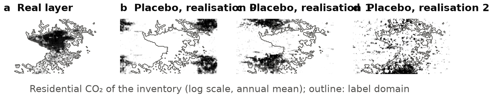
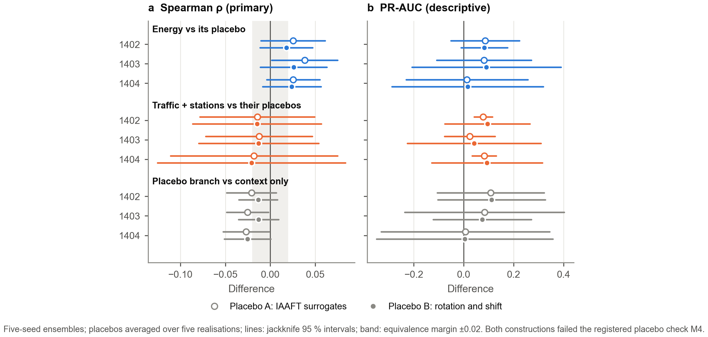
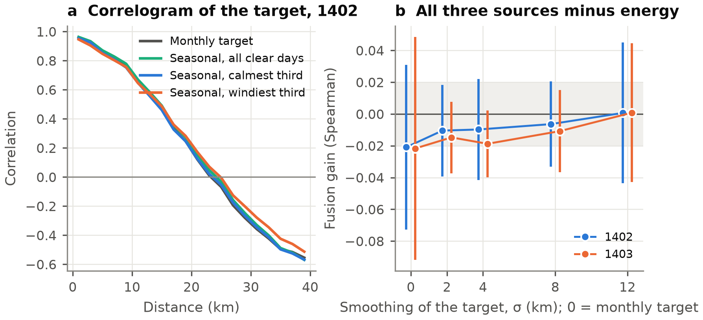

# Placebo branches separate architecture from information in fusing urban data for satellite NO₂ hotspot mapping

**Fatemeh Vafaeian¹, Vahid Khatibi¹\***

¹ [Affiliation to be completed]  
\* Corresponding author: [e-mail to be completed]

*Draft manuscript, 13 November 2026. All numbers come from the runs on branch `paper_fusion` of the project repository
(`docs/paper/fusion_paper/results_stage1`, `results_stage2`, `results_tests`, `results_check`, `results_v2`). Items in
[brackets] are to be completed before submission.*

---

## Highlights

- Ablations that add or remove a data source also add or remove a model branch.
- Placebo branches, the same layers at a random location, separate the two.
- An information-free branch changed skill as much as real urban data sources did.
- Of traffic, energy and station data, only energy beat its placebo, by a small margin.
- Two different placebo constructions agreed; neither kept the texture of a one-city map within tolerance.

---

## Abstract

Fusing heterogeneous urban data is a common route to better maps of emissions and air pollution. Its benefit is usually
judged by ablation: a data source is added to or removed from a multi-branch network, and the change in skill is taken
as the value of the source. Adding a source, however, also adds a branch, and with it capacity and a new way of
combining inputs.

We separate the two with **placebo branches**: the layers of a source moved to a random location, keeping their values
and, as far as possible, their spatial texture and internal correlation. Two constructions were used, IAAFT surrogates
and rotation with a cyclic shift. We apply this control to the fusion of traffic, energy-inventory and station data
with urban-form context for mapping the intra-urban pattern of monthly TROPOMI NO₂ in Tehran (2,436 cells of 1 km). The
protocol was pre-registered and used 22-km spatial blocks, a held-out year, five seeds and five placebo realisations. We
also vary the resolution of the target, by compositing calm and windy days and by smoothing it with Gaussian kernels of
2–12 km.

- **Energy.** Energy layers beat their placebos consistently but modestly: Spearman +0.018 to +0.038 over three years
  and two constructions, 26 of 30 single seeds positive.
- **Traffic and stations.** Traffic and station layers did not beat their placebos: −0.012 to −0.021, all 30 seeds
  negative.
- **Architecture.** A single information-free branch changed skill as much as the real sources did: it lowered the
  Spearman correlation of the map by 0.013–0.027 and raised hotspot PR-AUC by up to 0.11.
- **Lineage.** Block-cross-validated, the urban-form layers predicted the residential, industrial and commercial
  emission layers with R² = 0.98, 0.95 and 0.89.
- **Target resolution.** Fusion did not improve the map at any target resolution, and calm-day composites were not
  sharper than windy-day composites.

Neither placebo construction met the registered texture tolerance: moving the single urban core of a bounded map either
reshapes it or splits it. Gains of data fusion of the size studied here cannot be attributed to the data without such a
control.

**Keywords:** data fusion; multimodal learning; ablation; placebo control; surrogate data; TROPOMI; NO₂; urban
emissions; spatial cross-validation; Tehran

---

## 1. Introduction

Maps of where a city burns fuel guide emission inventories and mitigation, and satellite NO₂ has become a practical
tracer of urban combustion (Beirle et al., 2019; Goldberg et al., 2024). Models that predict the NO₂ pattern from urban
data can screen cities for combustion hotspots and test inventories. Many such models fuse several data sources —
traffic models, emission inventories, monitoring stations, satellite imagery, points of interest — in networks with one
branch per source (Zeng et al., 2025; Mena et al., 2025), following the broader practice of multimodal and cross-domain
fusion (Zheng, 2015; Baltrušaitis et al., 2019).

Whether fusion helps is usually judged by **ablation**. A source is removed from, or added to, the network, and the
change in skill is credited to that source. In a multi-branch network, however, a source is also a branch. Adding it
adds an encoder, parameters and, in gated or attention-based fusion, a new competitor for the weights. A change in skill
can therefore come from the information in the source or from the change in architecture. The machine-learning
literature has shown that the architecture of fusion is not neutral:
- multimodal networks can be worse than their best unimodal part because they overfit (Wang et al., 2020);
- modalities compete during joint training (Huang et al., 2022);
- the cross-modal interactions credited to a model are often absent (Hessel & Lee, 2020).

Modality importance is usually measured by permuting a modality at test time (Gat et al., 2021) or by Shapley values
over subsets (Hu et al., 2022). Both measure reliance on a modality, not the value of its information over a branch of
the same shape.

Ecology offers a sharper control. Fourcade et al. (2018) fitted species distribution models to **pseudo-predictors**
made from paintings and found that common evaluation statistics rated many of them as good as models with real
environmental predictors. Spatially structured random fields can carry skill on their own (Meyer et al., 2019; Behrens
& Viscarra Rossel, 2020), and surrogate fields that keep a map's autocorrelation but not its location are standard
null models in spatial statistics (Schreiber & Schmitz, 1996; Wagner & Dray, 2015; Burt et al., 2020). We found no
study in multimodal or multi-source spatial fusion that uses such a surrogate as a **placebo branch**: a branch of the
same shape as a real source, trained in the same network, whose comparison with the real source isolates the
information in the source from the effect of the branch.

A second question is when fusion can pay at all. If two sources differ only at scales finer than the target resolves,
the target cannot reward their difference. Correlations rise as data are aggregated (Gehlke & Biehl, 1934), and the
choice of support changes model skill and predictor importance (Gotway & Young, 2002; Friedrichs-Manthey et al., 2020;
Moudrý et al., 2023; Zhalehdoost & Taleai, 2025). In Tehran, the road and building emission layers of the inventory
correlate at 0.58 in single cells but at 0.998 once smoothed over 8 km, while the monthly TROPOMI pattern varies over
tens of kilometres. A companion study found that fusing these sources did not beat the best single source (Vafaeian &
Khatibi, in review). Whether fusion would pay with a sharper target has not been tested. Calm-day composites of TROPOMI
have been used to reduce the smearing of NO₂ by wind (Goldberg et al., 2024; Liu et al., 2024), which offers a way to
vary the effective resolution of the target with real data.

We ask three questions, in a pre-registered design:
1. **Information.** Does each urban data source carry information beyond a placebo branch of the same shape?
2. **Architecture.** How large is the effect of the branch itself, compared with the effect of a real source?
3. **Target support.** Does the value of fusion change when the satellite target is sharper (calm days) or coarser
   (smoothed)?

## 2. Study area and data

### 2.1 Grid, years and target

The grid covers 50.85–51.90°E and 35.35–35.95°N with 72 × 126 cells of 1/120° (about 0.75 × 0.93 km). The label domain
holds the 2,436 cells of the three central counties (Tehran, Rey, Shemiranat) that the emission inventory assigns any
CO₂.

We use three Iranian (Solar Hijri) years: 1402 (March 2023 – March 2024) and 1403 for development, and 1404 (March 2025 –
March 2026) as a held-out year.

The target is the monthly mean tropospheric NO₂ column of the TROPOMI offline level-3 product on the grid:
- log-transformed;
- standardised over the domain in each month (z), so that only the spatial pattern is kept.

The target is smooth: its correlogram crosses zero at about 24 km, and its effective number of independent cells is
about 5 per month (Vafaeian & Khatibi, in review).

### 2.2 Data sources

| Source | Layers | Inputs per cell |
|---|---|---|
| **Traffic** | road-transport CO₂ of a bottom-up inventory; road length in four classes; peak-hour vehicle-kilometres and volume-to-capacity ratio of a traffic assignment | 21 |
| **Energy** | residential, commercial, industrial and power-sector CO₂ of the same inventory; monthly heating degree-days | 13 |
| **Stations** | CO of the municipal monitoring network, interpolated by inverse distance | 3 |
| **Context** (always present) | GHSL population, total and non-residential building volume, VIIRS night lights, industrial land share, ERA5 temperature and wind | 17 |

Every spatial layer enters with its value in the cell and its means over square windows of half-width 3 and 9 cells (up
to about 7.6 km). The station layer is rebuilt for each fold without the stations within 2 km of the test block, which
avoids pre-processing leakage (Kapoor & Narayanan, 2023). For 1404, the inventory and traffic layers of 1403 stand in.

**Shared lineage.** The sources are not independent.
- The residential and commercial CO₂ of the inventory is allocated in proportion to GHSL residential and non-residential
  building volume. Industrial CO₂ is allocated by OSM industrial area. The context source contains these same layers.
- The trips of the traffic model are distributed by GHSL population and non-residential volume.
- The station layer is a smooth interpolation of a few points.

Emission inventories inherit the spatial pattern of their allocation proxies (Geng et al., 2017; Gately & Hutyra,
2017; Mu et al., 2022); here the proxies are also given to the model as a separate source.

## 3. Methods

### 3.1 Fusion network

Every model is the fusion network of the companion study, without a graph:
- **Encoders:** one encoder per source, a two-layer MLP with 32 hidden units and dropout 0.1.
- **Fusion:** either a softmax gate over the encoders for every cell and month (**gated fusion**; Arevalo et al.,
  2017), or concatenation of all inputs into one encoder (**early fusion**).
- **Head:** a linear head predicts z.
- **Training:**
  - AdamW, learning rate 3 × 10⁻³, weight decay 10⁻⁴, 300 epochs, mean squared error;
  - all hyper-parameters fixed before the study;
  - five seeds, with the prediction the mean of the five, as in the companion study.
- **Context:** context is always a branch, so a model with "energy" has two branches (energy, context), and the
  context-only model has one.

### 3.2 Placebo branches

A placebo of a source keeps what a branch can exploit without information on where the city is: the values, the
spatial texture and the correlation between the layers of the source. It loses the location. We used two
constructions.

**Placebo A (registered first): IAAFT surrogates.**
- Each layer's annual map is mirror-padded to twice its size, so the field is periodic without edge jumps.
- Multivariate IAAFT surrogates are generated (Schreiber & Schmitz, 1996):
  - the same random phase field is added to the Fourier phases of every layer of a source, which keeps their
    cross-spectra;
  - 100 iterations alternate between restoring the amplitude spectrum and restoring the exact values by rank.
- The original window is cut out, and its values are set by rank to the real values.
- Monthly layers are the surrogate times the city-wide monthly factor of the real layer.

**Placebo B (the registered fallback): rotation and cyclic shift.**
- Every layer of a source is rotated by 180° and shifted cyclically, month by month, by the same random offset: between
  one quarter and three quarters of the grid in each direction.
- It keeps the values, the monthly cycle and the correlation between the layers of the source exactly, and the texture
  everywhere except at the wrap-around seams.

**For both constructions:**
- City-wide layers (degree-days) are copied unchanged, so a placebo branch has as many inputs as the real one.
- A placebo depends on the realisation, not on the year: it stays in place across years, as real static layers do.
- We use five realisations. Every placebo comparison averages scores over the five, also inside the jackknife and inside
  the randomisation test.

### 3.3 Target versions

**Composites by wind.**
- The daily TROPOMI fields (cloud fraction < 0.3) of each Jalali season are ranked by the city-mean wind speed at
  10 UTC (ERA5-Land).
- Composites:
  - **calm** = mean of the calmest third of the clear days;
  - **windy** = the windiest third, the same number of days;
  - **all** = every clear day.
- A composite is placed on the middle month of its season, which gives 4 target maps per year.
- Seasons rather than months were registered because calm-day coverage needs several months of data (Liu et al., 2024).
- Each third held 15–29 days.

**Smoothed targets.**
- The monthly target is smoothed with Gaussian kernels of σ = 2, 4, 8 and 12 km by normalised convolution over the
  domain, then standardised again.
- To avoid leakage, the training labels of every fold are smoothed over that fold's training cells only. The test
  truth is the field smoothed over all cells. No value of a test block or its buffer enters a training label.

### 3.4 Validation and metrics

**Validation.**
- The domain is divided into 22-km blocks (12 blocks). Each block is held out once, and training cells within 2 km of
  it are removed (Roberts et al., 2017).
- For 1404, every fold trains on the training blocks of 1402 and 1403 and predicts the held-out block of 1404: new
  places in a new year (Meyer et al., 2018).

**Metrics.**
- **Primary:** Spearman correlation between predicted and observed z over the domain, averaged over the time steps that
  have a target.
- **Descriptive:** PR-AUC of the monthly top 10 % (hotspots), which rests on very few independent units and varies
  strongly between seeds.

### 3.5 Inference

A difference between two models is computed on identical out-of-fold predictions. Each comparison gets:
- **Interval:** a delete-one-block jackknife with K − 1 degrees of freedom.
- **Randomisation test:** an exact block sign-flip test (2¹² assignments) on rank-normalised predictions.
- **Verdict**, with a margin of δ = 0.02 (Lakens, 2017): superior, equivalent, non-inferior, inferior or inconclusive.
- **Holm's adjustment** (Holm, 1979) within each family.

**Contrasts between target versions** (F3, F4) are computed per block and pooled over the two development years:
- jackknife over blocks;
- sign-flip of the cell-weighted per-block contrasts.

**Seeds.** Every seed of the candidate is compared with the matching placebo realisation.

### 3.6 Pre-registration

The protocol was registered before any run (`docs/paper/fusion_paper/preregistration_fusion_v1.md`, commit `9e28ddc`).

**Family F** (1402, 1403; Holm):
- **F1:** context + energy vs context + placebo energy.
- **F2:** context + energy + traffic + stations vs context + energy + placebo traffic + placebo stations.
- **F3:** the fusion gain on calm minus windy composites.
- **F4:** the relative fusion gain on the native target minus that on the target smoothed with 8 km.
- The fusion gain is Spearman(all three sources, gated) − Spearman(energy, gated). The relative gain divides it by
  1 − Spearman(energy).

**Family C** (1404): C1 and C2 repeat F1 and F2 on the held-out year.

**Checks:**
- **Before the stage-2 models:**
  - **M1:** the all-day composite matches the monthly target (Spearman ≥ 0.95).
  - **M2:** calm composites are sharper than windy ones: zero crossing of the correlogram ≥ 2 km shorter **and**
    correlation at 8–10 km ≥ 0.05 lower, in both years.
  - **M3:** split-half reliability ≥ 0.90.
  - If M2 failed, F3 was to be reported as uninformative and removed from its family.
- **Before the placebo verdicts are read — M4:**
  - Over the five realisations, on the full grid, the median |Spearman| between placebo and real layer must be < 0.10
    (location removed).
  - The correlogram must stay within ±0.05 of the real one at 0–20 km (texture kept).
  - If more than two realisations failed, the placebo verdicts were to be labelled "placebo check failed" and placebo B
    run as a new version.
- **Lineage audit** (descriptive): block-CV R² of each energy, traffic and station layer from the context layers, with
  OLS and gradient boosting.

**Expected directions, written before the runs:**
- F1: equivalent or inconclusive.
- F2: equivalent or inferior.
- F3: positive but probably inconclusive.
- F4: positive.

**Deviation.** M4 failed for placebo A; as registered, placebo B was run, and it also failed M4 (Section 4.4). Both
sets of placebo verdicts are reported, with that label.

## 4. Results

### 4.1 Information beyond the placebo

**Table 1.** Real source minus placebo branch (gated fusion; Spearman; five-seed ensembles, placebos averaged over five
realisations), for placebo A (IAAFT) and placebo B (rotation and shift). Intervals are delete-one-block jackknife 95 %
intervals. p is the one-sided block sign-flip p-value after Holm adjustment within the family. Both constructions
failed check M4 (Section 4.4).

| Test | Comparison | Year | Placebo | Δ | 95 % interval | Seeds > 0 | Verdict | p (Holm) |
|---|---|---|---|---|---|---|---|---|
| F1 | energy vs placebo energy | 1402 | A | +0.025 | −0.010, +0.061 | 4 / 5 | non-inferior | 0.10 |
| | | | B | +0.018 | −0.011, +0.047 | 4 / 5 | non-inferior | 0.20 |
| F1 | | 1403 | A | +0.038 | +0.002, +0.075 | 5 / 5 | superior, not significant after Holm | 0.056 |
| | | | B | +0.026 | −0.011, +0.063 | 5 / 5 | non-inferior | 0.037 |
| C1 | | 1404 | A | +0.025 | −0.004, +0.055 | 4 / 5 | non-inferior | 0.082 |
| | | | B | +0.024 | −0.009, +0.056 | 4 / 5 | non-inferior | 0.030 |
| F2 | traffic + stations vs their placebos, energy present | 1402 | A | −0.014 | −0.078, +0.049 | 0 / 5 | inconclusive | 1.0 |
| | | | B | −0.015 | −0.086, +0.057 | 0 / 5 | inconclusive | 1.0 |
| F2 | | 1403 | A | −0.012 | −0.072, +0.047 | 0 / 5 | inconclusive | 1.0 |
| | | | B | −0.013 | −0.080, +0.054 | 0 / 5 | inconclusive | 1.0 |
| C2 | | 1404 | A | −0.018 | −0.111, +0.075 | 0 / 5 | inconclusive | 0.68 |
| | | | B | −0.021 | −0.125, +0.084 | 0 / 5 | inconclusive | 0.71 |

**Energy.** Energy beat its placebo in every year and with both constructions, in 26 of 30 single seeds, by
0.018–0.038.
- The jackknife intervals include zero in five of the six comparisons, so the four-way verdicts are non-inferior.
- With placebo B, the randomisation tests of 1403 and 1404 remain below 0.05 after Holm adjustment.
- The evidence that the energy layers carry information beyond their values and texture is consistent but modest.

**Traffic and stations.** Given energy, the real traffic and station layers scored below their placebos in every
year, with both constructions and in all 30 seeds. The intervals are wide and the comparisons inconclusive. Still, no
year, construction or seed points to information that a relocated copy of the same layers does not also provide.

**PR-AUC** (descriptive). The real sources scored higher than their placebos:
- energy +0.08 to +0.09 in 1402–1403 and +0.01 to +0.02 in 1404;
- traffic and stations +0.03 to +0.10.

These numbers are smaller than the spread over placebo realisations: the placebo-energy PR-AUC ranged from 0.52 to
0.85 (A) and 0.61 to 0.74 (B) in 1403.

### 4.2 The effect of the branch itself

**Table 2.** Placebo branch minus the context-only model (secondary estimates, no verdict), for placebo A and B.
Spearman with 95 % jackknife intervals; PR-AUC point estimates.

| Fusion | Metric | Placebo | 1402 | 1403 | 1404 |
|---|---|---|---|---|---|
| gated | Spearman | A | −0.021 (−0.049, +0.007) | −0.025 (−0.048, −0.002) | −0.027 (−0.053, −0.001) |
| | | B | −0.014 (−0.035, +0.008) | −0.013 (−0.035, +0.009) | −0.025 (−0.051, +0.001) |
| early | Spearman | A | −0.019 (−0.045, +0.006) | −0.023 (−0.062, +0.016) | – |
| | | B | −0.012 (−0.038, +0.014) | −0.015 (−0.045, +0.015) | – |
| gated | PR-AUC | A | +0.108 | +0.084 | +0.007 |
| | | B | +0.112 | +0.074 | +0.005 |
| early | PR-AUC | A | +0.049 | +0.089 | – |
| | | B | +0.096 | +0.094 | – |

Adding one branch without information changed the model as much as adding a real source:
- **Ranking:** it lowered the Spearman correlation of the map by 0.012–0.027.
- **Hotspots:** it raised hotspot PR-AUC in the development years by 0.05–0.11 with both constructions.

For comparison, the real energy source changed the same metrics, relative to context only, by:
- Spearman +0.004 / +0.013 / −0.001;
- PR-AUC +0.19 / +0.17 / +0.02.

With early fusion, real energy did not beat placebo energy in PR-AUC (A: −0.004 and −0.005; B: −0.052 and −0.010),
while it kept a Spearman advantage of +0.021 to +0.037.

### 4.3 Target support

**Checks.**
- **M1 passed:** the composite of all clear days matched the monthly target (Spearman 0.98 in both years).
- **M3 passed:** split-half reliability was 0.92–0.96.
- **M2 failed:** calm-day composites were not sharper than windy-day composites.
  - The correlogram crossed zero at 23.6 km (calm) and 24.9 km (windy) in 1402, and at 23.9 and 24.7 km in 1403.
  - The correlation at 8–10 km was 0.753 against 0.756, and 0.754 against 0.776.
- By the registered rule, **F3 is uninformative** (D = −0.004, 95 % interval −0.034 to +0.025) and was removed from the
  Holm family.

**Table 3.** Fusion gain, Spearman(all three sources) − Spearman(energy), gated fusion, on every target version.

| Target | 1402 | 1403 | 1404 |
|---|---|---|---|
| monthly (native) | −0.021 | −0.022 | −0.028 |
| seasonal, all clear days | −0.017 | −0.016 | |
| seasonal, calm third | −0.026 | −0.015 | |
| seasonal, windy third | −0.009 | −0.023 | |
| smoothed, σ = 2 km | −0.010 | −0.015 | |
| smoothed, σ = 4 km | −0.010 | −0.019 | |
| smoothed, σ = 8 km | −0.006 | −0.011 | −0.008 |
| smoothed, σ = 12 km | +0.001 | +0.001 | |

- **Fusion never improved the ranking.** Its small loss on the native target shrank as the target was smoothed and
  vanished at 12 km.
- **F4.** The registered contrast was −0.180 (95 % interval −0.549 to +0.189; inconclusive). Its direction is opposite to
  the prediction: the relative fusion gain was not larger on the sharper target, it was more negative.
- **Skill falls with smoothing.** Skill fell for every model as the target was smoothed (the energy model from 0.92–0.93
  to 0.86 at 12 km), probably because the models' neighbourhood inputs reach only about 7.6 km.
- **Technical note.** In the per-block contrast of F4, a few edge blocks of 3–5 cells had a reference Spearman of 1, so
  their relative gain was undefined and they left the block-level sign-flip test. The jackknife is not affected.

### 4.4 Placebo check and lineage audit

**Check M4.** Both constructions removed the location, and neither kept the texture within the registered tolerance.

| Construction | Median \|Spearman\| with the real layer | Median of the largest correlogram difference, 0–20 km | Realisations passing |
|---|---|---|---|
| A (IAAFT) | 0.05–0.09 | 0.21–0.36 | 0 of 5 |
| B (rotation and shift) | 0.04–0.10 | 0.10–0.20 | 0 of 5 |

- With placebo B, the texture differs only at the wrap-around seams. The single urban core of Tehran, which fills much
  of the grid, is cut by them (Fig. 1).
- In a bounded grid with one urban core, a relocation that removes the location either reshapes the core (A) or splits
  it (B).
- By the registered rule, all placebo verdicts carry the label "placebo check failed".

**Lineage audit.**

**Table 4.** Block-cross-validated R² (12 blocks of 22 km, 2-km buffer) of the annual map of each layer predicted from
the context layers (population, building volume, night lights, industrial share, with their box means), 1402;
1403 within ±0.02 except where stated.

| Source | Layer | Gradient boosting | OLS |
|---|---|---|---|
| energy | residential CO₂ | 0.98 | 0.89 |
| energy | industrial CO₂ | 0.95 | 0.60 |
| energy | commercial CO₂ | 0.89 | 0.77 |
| energy | power-plant CO₂ | < 0 | 0.00 |
| traffic | peak vehicle-kilometres | 0.71 | 0.69 |
| traffic | road CO₂ | 0.47 | 0.50 |
| traffic | volume-to-capacity ratio | 0.36 | 0.26 |
| traffic | road length by class | < 0.03 | 0.06–0.15 |
| stations | CO, interpolated | < 0 (−0.77 / −0.05) | < 0 (−0.43 / −0.68) |

Three of the four energy layers are almost fully predictable from the urban-form layers that the model already
receives. The power-plant layer, the road network and the station layer are not, but they did not beat their
placebos either.

## 5. Discussion

### 5.1 Why a placebo control is needed

The placebo branch answers a question that ablation cannot: is the change in skill due to the data or to the branch?
Here the answer differed between metrics.
- **Ranking:** an extra branch, with any data, cost ranking skill. The real energy layers more than recovered this
  cost; traffic and station layers did not.
- **Hotspots:** an extra branch raised hotspot PR-AUC on its own, by 0.05–0.11 in the development years. A large part
  of the PR-AUC gain of adding a real source is therefore what any branch would have given.

A reader of a standard ablation table would have credited the energy inventory with about +0.19 in PR-AUC over context
in gated fusion. The placebo shows that a relocated copy of the same layers gives +0.07 to +0.11.

With a single target and few independent units, such architecture effects are of the same size as the effects usually
reported for data sources. This agrees with machine-learning evidence that fusion architectures overfit and that
modalities compete (Wang et al., 2020; Huang et al., 2022), and with the ecological finding that meaningless predictors
can look skilful (Fourcade et al., 2018).

**A perfect placebo is hard to build.** Neither construction met the registered texture tolerance, because the
non-stationary map of a single city cannot be moved inside a bounded grid without being reshaped or cut. The two
constructions err in different ways — A reshapes the texture, B keeps it but adds seams. They nevertheless gave the same
signs and similar sizes for every comparison, so the conclusions do not rest on one construction. A placebo drawn from
the same layers of another city (a donor-city placebo) would keep a whole urban core and is the natural next step.

### 5.2 Why the urban sources add little

Two reasons are visible in the data.
- **The sources share their lineage.** The energy inventory is allocated by the same building volumes that the context
  source holds: the context layers predict the residential, industrial and commercial emission layers with R² of
  0.98, 0.95 and 0.89 (Table 4). The traffic model distributes trips by the same population. The station layer is a smooth
  interpolation of a few points. What remains in the energy layers beyond context — the power plants, the split
  between residential and total volume, the county totals — is small, and so is the information measured against the
  placebo.
- **The target is too smooth to reward differences between sources.** The target has about five independent units per
  month, and the sources become almost identical at the scale over which it varies.

Smoothing the target further removed the small cost of fusion rather than revealing a benefit. The native target is
already coarse enough that the sources are redundant, and coarser targets only make them more so.

### 5.3 Calm days did not sharpen the target

Low-wind compositing sharpens TROPOMI NO₂ around point sources and in some cities (Goldberg et al., 2024; Liu et al.,
2024). For Tehran, seasonal composites of the calmest third of the days were not sharper than those of the windiest
third: both decorrelated at about 24 km. At this scale the pattern of the city is set by the footprint of the instrument
(3.5 × 5.5 km), by averaging over many days and by the urban form itself rather than by daily transport. A sharper target
for intra-urban fusion would need another instrument or oversampling, not wind selection.

### 5.4 Recommendations

1. **Report a placebo branch next to every ablation of a data source.**
   - Use several realisations and, if possible, more than one construction.
   - Run it with every fusion type compared.
   - Check that the placebo keeps the texture: a single-city map is the hard case, and a donor-city placebo may be needed.
2. **Use a rank metric over the whole map as the primary metric.** Treat top-decile metrics as descriptive when the
   target has few independent units.
3. **Report the lineage of every source.** Measure how much of it the other sources predict before training.
4. **Report single seeds and placebo realisations, not only ensembles.**

### 5.5 Limitations

- **Scope:** one city, one target product and one family of fusion networks without a graph.
- **Placebo:** both placebo constructions failed the registered texture check. Their agreement is the basis of the
  placebo results, not a passed check. A smooth surrogate can itself act as a spatial basis (Behrens & Viscarra
  Rossel, 2020).
- **Low power:** the effective sample size of the target is about five per month, so most comparisons have low power.
  The randomisation test was liberal for Spearman in a null calibration of the companion study.
- **Target support:** the calm–windy contrast rests on four composites per year, and wind at 10 m is a proxy for the
  transport wind. The smoothed targets were evaluated with the neighbourhood inputs fixed at about 7.6 km, and skill
  fell for every model as the target was smoothed.
- **Held-out year:** 1404 used the 1403 inventory and traffic layers.

## 6. Conclusions

Ablations of data sources in multi-branch fusion networks confound the information in a source with the effect of its
branch. Placebo branches — the same layers at a random location — separate the two at the cost of a few extra runs.

In mapping the intra-urban NO₂ pattern of Tehran from TROPOMI:
- energy-inventory layers beat their placebos consistently but modestly, with both constructions;
- traffic and station layers did not;
- one information-free branch changed skill as much as the real sources did;
- the energy layers were largely predictable from the urban-form context;
- fusion did not help at any target resolution, and calm-day composites did not sharpen the target.

Placebo construction for a single non-stationary urban map is itself difficult and should be checked. We recommend
placebo branches as a standard control whenever the value of a data source is inferred from a multi-branch model.

---

## Data and code availability

*[Draft: confirm the bracketed items before submission.]*

- **Code and results.** The code, configurations, pre-registration, run registry and every result table are openly
  available at https://github.com/fatemehvv/Tehran-carbon (branch `paper_fusion`).
  - Placebo branches: `src/tehran_carbon/data/sources/placebo.py`.
  - Composites: `src/tehran_carbon/data/sources/composite.py`.
  - Smoothed targets: `src/tehran_carbon/data/target_support.py`.
  - Tests: `src/tehran_carbon/analysis/fusion_eval.py`.
  - Checks and lineage audit: `src/tehran_carbon/analysis/fusion_checks.py`.
  - Figures: `src/tehran_carbon/viz/fusion_figures.py`.
  - A versioned copy will be archived on Zenodo on acceptance [DOI to be added].
- **Data.** Public data (TROPOMI, ERA5, VIIRS, GHSL) and the Earth Engine export scripts are listed as in the companion
  study. The energy, traffic and station data are [as in the companion study].

## CRediT authorship contribution statement

*[Draft: to be confirmed by both authors.]*

- **Fatemeh Vafaeian:** Conceptualization, Methodology, Software, Data curation, Formal analysis, Investigation,
  Visualization, Writing – original draft.
- **Vahid Khatibi:** Supervision, Validation, Writing – review & editing.

## Funding

[This research did not receive any specific grant from funding agencies in the public, commercial or not-for-profit
sectors.]

## Acknowledgements

This publication contains modified Copernicus Sentinel data (2023–2026) and modified Copernicus Climate Change Service
information (2023–2026).

## Declaration of generative AI and AI-assisted technologies in the writing process

*[Draft: adapt it so that it describes exactly how the tool was used.]*

During the preparation of this work the authors used Claude (Anthropic) to help write and review analysis code and to
draft and edit the text. After using this tool, the authors reviewed and edited the content as needed and take full
responsibility for the content of the published article.

## Declaration of competing interest

The authors declare that they have no known competing financial interests or personal relationships that could have
appeared to influence the work reported in this paper.

---

## References

*DOIs checked against Crossref on 13 November 2026 unless marked [check].*

- Arevalo, J., Solorio, T., Montes-y-Gómez, M., & González, F. A. (2017). Gated multimodal units for information fusion. ICLR Workshop Track. arXiv:1702.01992.
- Baltrušaitis, T., Ahuja, C., & Morency, L.-P. (2019). Multimodal machine learning: a survey and taxonomy. *IEEE Transactions on Pattern Analysis and Machine Intelligence*, 41, 423–443. https://doi.org/10.1109/TPAMI.2018.2798607 [check]
- Behrens, T., & Viscarra Rossel, R. A. (2020). On the interpretability of predictors in spatial data science: the information horizon. *Scientific Reports*, 10, 16737. https://doi.org/10.1038/s41598-020-73773-y [check authors and pages]
- Beirle, S., Borger, C., Dörner, S., Li, A., Hu, Z., Liu, F., Wang, Y., & Wagner, T. (2019). Pinpointing nitrogen oxide emissions from space. *Science Advances*, 5, eaax9800. https://doi.org/10.1126/sciadv.aax9800
- Burt, J. B., Helmer, M., Shinn, M., Anticevic, A., & Murray, J. D. (2020). Generative modeling of brain maps with spatial autocorrelation. *NeuroImage*, 220, 117038. https://doi.org/10.1016/j.neuroimage.2020.117038
- Fourcade, Y., Besnard, A. G., & Secondi, J. (2018). Paintings predict the distribution of species, or the challenge of selecting environmental predictors and evaluation statistics. *Global Ecology and Biogeography*, 27, 245–256. https://doi.org/10.1111/geb.12684
- Friedrichs-Manthey, M., Langhans, S. D., Hein, T., Borgwardt, F., Kling, H., Jähnig, S. C., & Domisch, S. (2020). From topography to hydrology — the modifiable area unit problem impacts freshwater species distribution models. *Ecology and Evolution*, 10, 2956–2968. https://doi.org/10.1002/ece3.6110
- Gat, I., Schwartz, I., & Schwing, A. (2021). Perceptual score: what data modalities does your model perceive? *Advances in Neural Information Processing Systems*, 34. arXiv:2110.14375.
- Gately, C. K., & Hutyra, L. R. (2017). Large uncertainties in urban-scale carbon emissions. *Journal of Geophysical Research: Atmospheres*, 122, 11242–11260. https://doi.org/10.1002/2017JD027359
- Gehlke, C. E., & Biehl, K. (1934). Certain effects of grouping upon the size of the correlation coefficient in census tract material. *Journal of the American Statistical Association*, 29, 169–170. https://doi.org/10.1080/01621459.1934.10506247 [check]
- Geng, G., Zhang, Q., Martin, R. V., Lin, J., Huo, H., Zheng, B., Wang, S., & He, K. (2017). Impact of spatial proxies on the representation of bottom-up emission inventories: a satellite-based analysis. *Atmospheric Chemistry and Physics*, 17, 4131–4145. https://doi.org/10.5194/acp-17-4131-2017
- Goldberg, D. L., Tao, M., Kerr, G. H., Ma, S., Tong, D. Q., Fiore, A. M., et al. (2024). Evaluating the spatial patterns of U.S. urban NOx emissions using TROPOMI NO₂. *Remote Sensing of Environment*, 300, 113917. https://doi.org/10.1016/j.rse.2023.113917
- Gotway, C. A., & Young, L. J. (2002). Combining incompatible spatial data. *Journal of the American Statistical Association*, 97, 632–648. https://doi.org/10.1198/016214502760047140
- Hessel, J., & Lee, L. (2020). Does my multimodal model learn cross-modal interactions? It's harder to tell than you might think! *Proceedings of EMNLP 2020*, 861–877. https://doi.org/10.18653/v1/2020.emnlp-main.62
- Holm, S. (1979). A simple sequentially rejective multiple test procedure. *Scandinavian Journal of Statistics*, 6, 65–70.
- Hu, P., Li, X., & Zhou, Y. (2022). SHAPE: an unified approach to evaluate the contribution and cooperation of individual modalities. *Proceedings of IJCAI-22*, 3064–3070. https://doi.org/10.24963/ijcai.2022/425
- Huang, Y., Lin, J., Zhou, C., Yang, H., & Huang, L. (2022). Modality competition: what makes joint training of multi-modal network fail in deep learning? (Provably). *Proceedings of ICML*, PMLR 162, 9226–9259.
- Kapoor, S., & Narayanan, A. (2023). Leakage and the reproducibility crisis in machine-learning-based science. *Patterns*, 4, 100804. https://doi.org/10.1016/j.patter.2023.100804
- Lakens, D. (2017). Equivalence tests: a practical primer for t tests, correlations, and meta-analyses. *Social Psychological and Personality Science*, 8, 355–362. https://doi.org/10.1177/1948550617697177
- Liu, F., Beirle, S., Joiner, J., Choi, S., Tao, Z., Knowland, K. E., Smith, S. J., Tong, D. Q., Ma, S., Fasnacht, Z. T., & Wagner, T. (2024). High-resolution mapping of nitrogen oxide emissions in large US cities from TROPOMI retrievals of tropospheric nitrogen dioxide columns. *Atmospheric Chemistry and Physics*, 24, 3717–3740. https://doi.org/10.5194/acp-24-3717-2024
- Mena, F., Pathak, D., Najjar, H., Sanchez, C., Helber, P., Bischke, B., et al. (2025). Adaptive fusion of multi-modal remote sensing data for optimal sub-field crop yield prediction. *Remote Sensing of Environment*, 318, 114547. https://doi.org/10.1016/j.rse.2024.114547
- Meyer, H., Reudenbach, C., Hengl, T., Katurji, M., & Nauss, T. (2018). Improving performance of spatio-temporal machine learning models using forward feature selection and target-oriented validation. *Environmental Modelling & Software*, 101, 1–9. https://doi.org/10.1016/j.envsoft.2017.12.001
- Meyer, H., Reudenbach, C., Wöllauer, S., & Nauss, T. (2019). Importance of spatial predictor variable selection in machine learning applications — moving from data reproduction to spatial prediction. *Ecological Modelling*, 411, 108815. https://doi.org/10.1016/j.ecolmodel.2019.108815
- Moudrý, V., et al. (2023). Scale mismatches between predictor and response variables in species distribution modelling: a review of practices for appropriate grain selection. *Progress in Physical Geography*, 47, 467–482. https://doi.org/10.1177/03091333231156362 [complete the authors]
- Mu, Q., Denby, B. R., Wærsted, E. G., & Fagerli, H. (2022). Downscaling of air pollutants in Europe using uEMEP_v6. *Geoscientific Model Development*, 15, 449–465. https://doi.org/10.5194/gmd-15-449-2022
- Roberts, D. R., Bahn, V., Ciuti, S., Boyce, M. S., Elith, J., Guillera-Arroita, G., et al. (2017). Cross-validation strategies for data with temporal, spatial, hierarchical, or phylogenetic structure. *Ecography*, 40, 913–929. https://doi.org/10.1111/ecog.02881
- Schreiber, T., & Schmitz, A. (1996). Improved surrogate data for nonlinearity tests. *Physical Review Letters*, 77, 635–638. https://doi.org/10.1103/PhysRevLett.77.635
- Vafaeian, F., & Khatibi, V. (in review). Reach, not graphs: neighbourhood reach explains the skill of distance-based graph neural networks in mapping intra-urban NO₂ hotspots from TROPOMI. [Journal to be added]
- Wagner, H. H., & Dray, S. (2015). Generating spatially constrained null models for irregularly spaced data using Moran spectral randomization methods. *Methods in Ecology and Evolution*, 6, 1169–1178. https://doi.org/10.1111/2041-210X.12407
- Wang, W., Tran, D., & Feiszli, M. (2020). What makes training multi-modal classification networks hard? *Proceedings of CVPR 2020*, 12695–12705. https://doi.org/10.1109/CVPR42600.2020.01271
- Zeng, J., Liu, Y., Zhang, G., Ding, J., Lin, Y., Yuan, J., & Li, Y. (2025). OpenCarbon: a contrastive learning-based cross-modality neural approach for high-resolution carbon emission prediction using open data. *Proceedings of IJCAI-25*, 9999–10007. https://doi.org/10.24963/ijcai.2025/1111
- Zhalehdoost, A., & Taleai, M. (2025). Unravelling the importance of spatial and temporal resolutions in modeling urban air pollution using a machine learning approach. *Scientific Reports*, 15, 27708. https://doi.org/10.1038/s41598-025-13639-3
- Zheng, Y. (2015). Methodologies for cross-domain data fusion: an overview. *IEEE Transactions on Big Data*, 1, 16–34. https://doi.org/10.1109/TBDATA.2015.2465959 [check]

---

## Figures

**Fig. 1.** The residential CO₂ layer of the inventory (log scale, annual mean) and two realisations of each placebo
construction: A, IAAFT surrogates; B, rotation by 180° and cyclic shift. Blue outline: label domain.

**Fig. 2.** Information and architecture. Real source minus placebo (energy; traffic + stations given energy) and
placebo branch minus context only, in Spearman (a, primary) and PR-AUC (b, descriptive), for 1402, 1403 and the held-out
year 1404. Open markers: placebo A; filled markers: placebo B. Lines: jackknife 95 % intervals; band: equivalence margin
±0.02.

**Fig. 3.** Target support. (a) Correlogram of the monthly target and of the seasonal composites of all, the calmest and
the windiest clear days, 1402. (b) Fusion gain (all three sources minus energy, Spearman) against the smoothing scale of
the target, with jackknife 95 % intervals.
