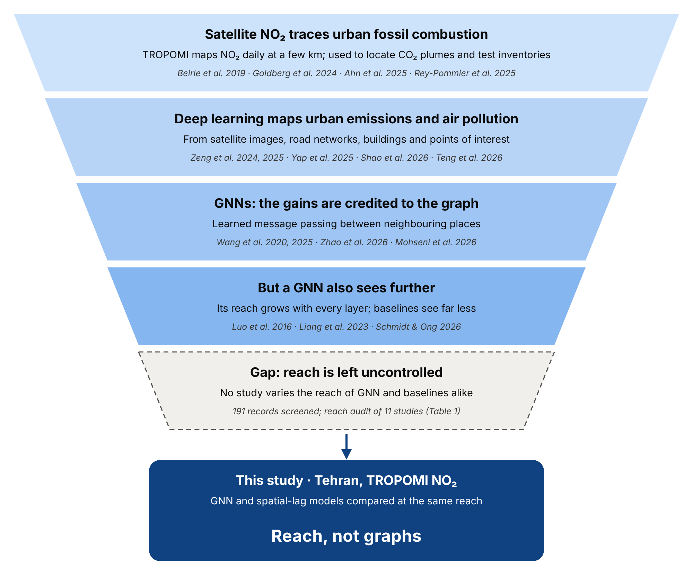
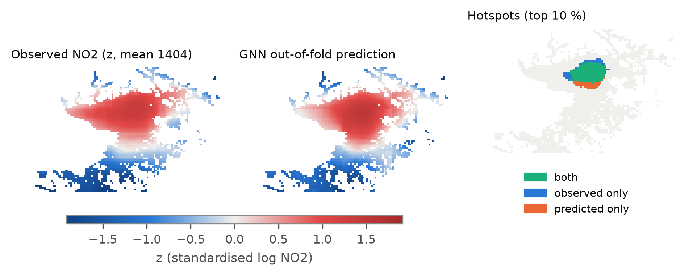
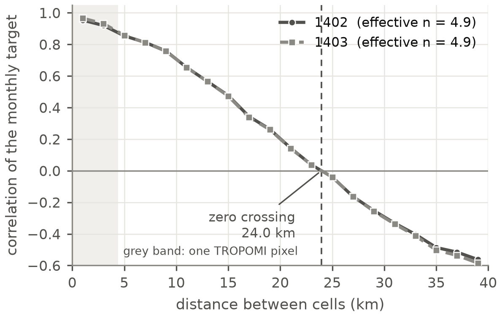
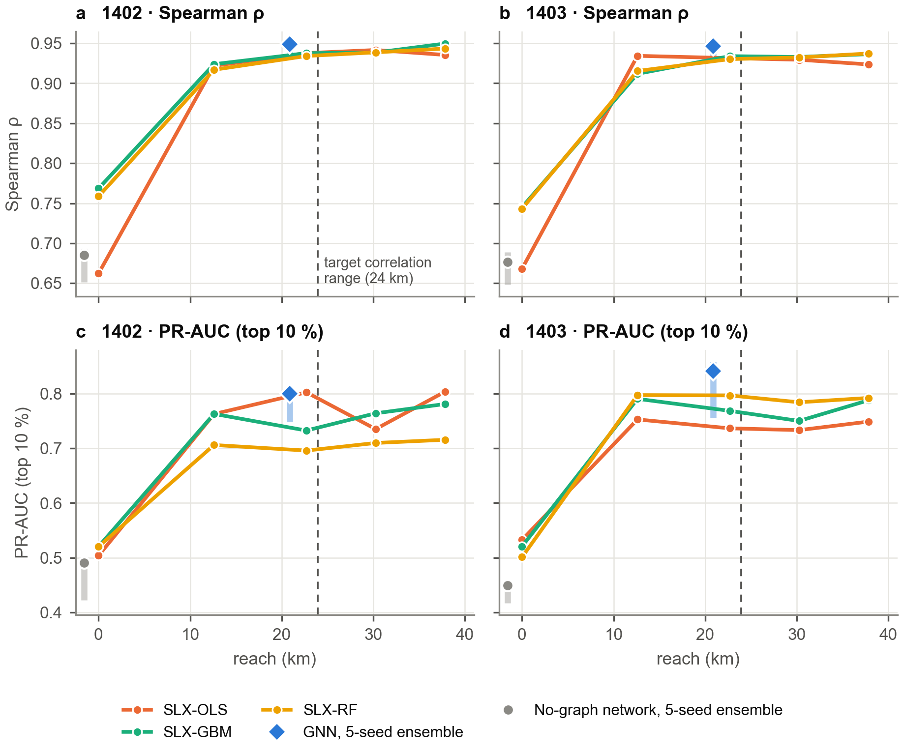
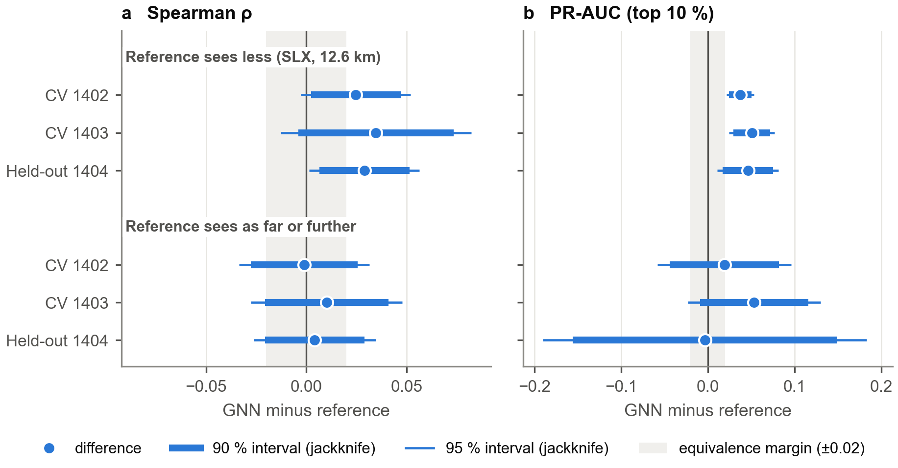
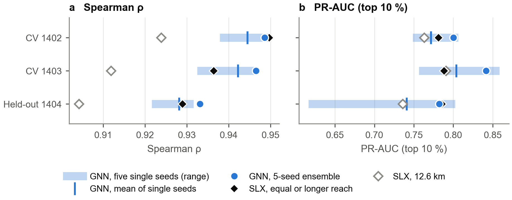

# Reach, not graphs: neighbourhood reach explains the skill of distance-based graph neural networks in mapping intra-urban NO₂ hotspots from TROPOMI

**Fatemeh Vafaeian¹, Vahid Khatibi¹\***

¹ [Affiliation to be completed]  
\* Corresponding author: [e-mail to be completed]

*Draft manuscript, 12 November 2026. All numbers come from the runs on branch `paper_TC` of the project repository (see
Data and code availability). Items in [brackets] are to be completed before submission.*

---

## Highlights

- On a distance-based graph, GNN skill for NO₂ hotspots tracks neighbourhood reach.
- Spatial-lag skill rises from 0 to 12.6 km and levels off before the 24-km range.
- At equal reach, no GNN advantage in Spearman was detected, in CV or on a new year.
- Seed averaging and a block bootstrap overstated the graph model's advantage.
- We propose reach-matched baselines set by the target's correlation length.

---

## Abstract

Graph neural networks (GNNs) are increasingly used to map urban emissions and air pollution, and their gains are
usually attributed to learning on a graph. A GNN, however, also sees further than the baselines it is usually compared
with. We separate the two for intra-urban NO₂ hotspots observed from space. In Tehran, a megacity with one of the highest
tropospheric NO₂ columns among large cities, we predict the monthly TROPOMI NO₂ pattern on a 1-km grid (2,436 cells)
from bottom-up traffic and energy emission layers, station data and urban-form data. A multi-scale GraphSAGE model on a
distance-based graph is compared with spatial-lag-of-X (SLX) models whose neighbourhood reach is varied from 0 to 38 km
and matched to that of the GNN. Validation uses 22-km spatial blocks and a held-out year, with leakage-free
pre-processing, five training seeds and exact block randomisation tests.

SLX skill rises from a Spearman correlation of 0.66–0.77 for the cell alone to 0.91–0.93 at a reach of 12.6 km, and
changes little beyond, short of the 24-km zero crossing of the target correlogram. At equal reach (22.7 km) in
cross-validation, a single GNN exceeds the best SLX model by 0.006–0.008 in Spearman, and the five-seed GNN ensemble
differs from the best SLX model at any reach by −0.001 and +0.010 (randomisation p = 0.58 and 0.13). On the held-out
year, SLX models at the GNN's reach of 30.3 and 37.8 km come within 0.003 of the GNN in Spearman. In hotspot PR-AUC the
five-seed ensembles lead by 0.04–0.06, but the mean single seed of the five-layer GNN does not (0.741 against 0.739).
With about five effective degrees of freedom in the target, equivalence within ±0.02 could not be established, and
evaluation choices drive verdicts: against a shorter-reach baseline, a block bootstrap declared the GNN better on the
held-out year, while exact block randomisation did not.

For this smooth satellite target and a distance-based graph, we find no evidence that graph structure adds skill beyond
neighbourhood reach. GNNs for spatial environmental mapping should be compared with reach-matched baselines.

**Keywords:** graph neural networks; receptive field; spatial lag of X; TROPOMI; NO₂; urban emissions; spatial
cross-validation; Tehran

---

## 1. Introduction

Policies to cut urban fossil CO₂ emissions need to know *where* in a city combustion is concentrated. Satellite NO₂ is increasingly used as a tracer of urban fossil combustion. NO₂ is co-emitted
with CO₂, it is short-lived, and since 2018 the TROPOMI instrument on Sentinel-5P has mapped it daily at a few
kilometres resolution (Beirle et al., 2019; Li et al., 2025). Recent work uses TROPOMI NO₂ to locate urban CO₂ plumes
and to estimate city emissions (Reuter et al., 2019; Ahn et al., 2025), to derive gridded NOx emissions
(Rey-Pommier et al., 2025), and to evaluate kilometre-scale bottom-up inventories (Goldberg et al., 2024). Models that
link emission and urban-form data to the observed NO₂ pattern can screen cities for combustion hotspots, test
inventories and support scenario analysis.

Deep learning, and graph neural networks in particular, has become the method of choice for such urban mapping tasks.
Recent models learn urban carbon emissions from satellite images and points of interest (Zeng et al., 2025), from road
networks and origin–destination flows (Zeng et al., 2024), at the level of individual buildings (Yap et al., 2025), or
across 329 Chinese cities with a graph-based multi-branch framework (Shao et al., 2026). GNNs with physically
motivated edges are used for air-quality prediction (Wang et al., 2020; Hettige et al., 2024). Graph networks have been
fused with high-resolution satellite data to predict PM2.5 and NO₂ (Wang et al., 2025), and used to map PM2.5 from
satellite and station data at scales from city regions to the globe (Bai et al., 2025; Teng et al., 2026; Yuan et al.,
2026). GraphSAGE has been applied to urban NO₂ (Gueterbock et al., 2025). The gains of these models are usually
credited to the graph: to learning how information should flow between neighbouring places.

A graph model, however, differs from a conventional model in two ways at once. It *learns* how to combine its
neighbourhood, and it *sees* a neighbourhood whose size grows with every message-passing layer: its receptive field, or
reach (Luo et al., 2016). Within graph learning, the receptive field is treated as a design choice to be tuned or
learned (Gao et al., 2025), and convolutional models have been found to fail where their effective receptive field is
too small for the process (Chen et al., 2026). Yet conventional spatial models used as baselines are often given
no neighbourhood at all (own-cell regression, random forests on local features), or a much smaller one than the GNN.
Under such comparisons, any advantage of the GNN may simply reflect that it looks further.

General graph learning has met this question before.

- **Linear models on pre-propagated features.** On citation and social graphs, linear models applied to features
  averaged over the same number of hops matched graph convolutional networks (Wu et al., 2019; Frasca et al., 2020).
- **Receptive field apart from depth.** The receptive field can be set separately from the number of layers
  (Gasteiger et al., 2019; Zeng et al., 2021).
- **Simple baselines.** Simple, fairly tuned baselines often match GNNs, and evaluation choices change the ranking of
  models (Shchur et al., 2018; Errica et al., 2020; Huang et al., 2021).
- **Spatial regression.** A spatial-regression reading of graph convolution relates the number of layers to the order
  of the spatial lag (Zhu et al., 2021).

These results concern non-spatial graphs, were obtained without spatial validation, and were not compared with
geographic spatial-lag baselines. Whether they hold for spatial environmental mapping has not been tested.

The spatial econometric answer to "the neighbours matter" is the spatial lag of X (SLX) model, which adds neighbourhood
means of the predictors (Halleck Vega & Elhorst, 2015). In air-quality science, land-use regression does the same with
buffers (Hoek et al., 2008). Both can be given any reach at negligible cost. Explicit neighbourhood information of this
kind helps other learners too:

- spatial-lag inputs improve neural networks (Xiao et al., 2023);
- spatial context in the modelling step improves convolutional classifiers of urban form (Fleischmann & Arribas-Bel,
  2024);
- kriging-based spatial-lag features improve tabular learners in soil mapping (Schmidinger et al., 2026).

Evaluation adds a second difficulty. Satellite NO₂ is strongly autocorrelated, so random cross-validation overstates
skill and blocks of the autocorrelation range are needed (Roberts et al., 2017; Ploton et al., 2020; Meyer & Pebesma,
2022). A recent review of machine learning for satellite NO₂ finds that reported skill varies widely between studies,
partly because their validation strategies differ (Zhang et al., 2026). The appropriate design depends on the intended
prediction task (Wadoux et al., 2021; Milà et al., 2022;
Linnenbrink et al., 2026). With blocks of tens of kilometres, a single city yields only a dozen blocks, and hotspots
concentrate in a few of them. Standard bootstrap inference is unreliable with so few, so unequal clusters (Cameron et
al., 2008; MacKinnon et al., 2023). The randomness of training also matters, because deep models vary from seed to seed
(Bouthillier et al., 2021). Pre-processing that uses information from the test area can inflate skill (Kapoor &
Narayanan, 2023).

The question has begun to surface in GIScience and environmental modelling:

- **GNNs against spatial regression.**
  - Graph convolutional networks have been compared with spatial and geographically weighted regression (Zhu et al.,
    2021; Liu et al., 2025).
  - Graph-based deep spatial regression fitted house prices better than spatial-regression baselines, in sample (Zhu
    et al., 2026).
  - GNNs have beaten spatial-lag, geographically weighted and gradient-boosting baselines for neighbourhood health
    outcomes under spatial cross-validation (Zhao et al., 2026).
  - They have also beaten linear, spatial-regression and XGBoost baselines for bike-share ridership (Mohseni et al.,
    2026).
- **The link to spatial regression and geostatistics.**
  - An attention-based GNN can be read as a generalised spatial regression model (Liang et al., 2023).
  - GNNs entered spatial statistics because message passing mimics interaction between geographical neighbours (Ma et
    al., 2025).
  - Neural networks for geospatial data admit a graph representation whose aggregation weights resemble kriging (Zhan &
    Datta, 2024).
  - Graph convolutions have been used for the spatial interpolation of correlated data (Abémgnigni Njifon &
    Schuhmacher, 2024).
- **Simple baselines remain strong.**
  - For urban NO₂ in Berlin, a random forest and a spatial GNN reached the same accuracy (R² ≈ 0.6; Schmidt & Ong,
    2026).
  - For city-level CO₂ in China, a graph model trained on city data alone did not beat an MLP or XGBoost. Its gains
    came from added provincial constraints (Shao et al., 2026).
  - In urban PM2.5 imputation, simple spatial interpolation outperformed standard data-driven GNNs unless physics was
    built in (Du et al., 2026).
- **Graph models are sensitive to evaluation.**
  - GNN residuals can remain spatially autocorrelated (Bao et al., 2024).
  - A GNN that generalised within a fixed graph struggled under leave-one-cluster-out validation (Flores et al., 2026).

Table 1 audits how far the GNN and its baselines see in comparable studies whose full text describes both.

- **What the baselines see.** In most studies, their own location only, a neighbourhood of a different size, or one
  that is not reported.
- **Two studies come close.**
  - Liang et al. (2023): the linear SLX baseline averaged over the same nearest stations as the GNN, but the nonlinear
    baseline saw no neighbours, and the GNN also drew on a second, non-geographic neighbourhood.
  - Schmidt & Ong (2026): the random forest received the measured NO₂ of the other stations, weighted as in the graph.
    It then matched the GNN (R² 0.58 against 0.61, on three test stations), as our results would predict.
- **What no study does.** None makes reach the object of the comparison. Where neighbourhoods coincide, it is
  incidental; no study varies the reach of both models or sets it by one rule.

**Table 1.** How far the GNN and its baselines see in comparable studies (full texts read; "n.r.": not reported).

| Study | Task and units | GNN and its reach | Baselines and what they see | Reach matched? |
|---|---|---|---|---|
| Wang et al. (2020) | PM2.5 forecasts; 184 cities, China | Cities linked if < 300 km apart with no ridge > 1,200 m between them; one graph step per 3-h step | MLP, LSTM, GRU: own city only. GC-LSTM: the same graph. nodesFC-GRU: all cities | Only for GC-LSTM, itself a graph model |
| Liang et al. (2023) | Trip generation; about 1,000 bike-share stations, New York | One attention layer over the 5 nearest and the 5 most similar stations | Linear SLX: nearby stations (apparently the same 5). Linear regression, XGBoost: own-station features only | Only for the linear SLX |
| Klemmer et al. (2023) | Four geographic regression datasets | GCN, GAT, GraphSAGE: 2 layers on a 5-nearest-neighbour graph | Exact Gaussian process: all training points | No: the baseline sees more |
| Hettige et al. (2024) | PM2.5 forecasts; 35 and 11 stations, Beijing and Shenzhen | Distance- and wind-weighted station graph; reach n.r. | Historical average, ODE models: none. DCRNN, STGCN: 3-step graph diffusion. AirFormer: 50 and 200 km. GTS: learned 30-nearest graph | No |
| Gueterbock et al. (2025) | Hourly NO₂ with TROPOMI; 8 sites, Bristol | GraphSAGE, 2 hops (3 and 5 sampled neighbours) | XGBoost, MLP, CNN: per-site inputs; neighbours n.r. | n.r. |
| Du et al. (2026) | PM2.5 imputation; 41 sensors, Fresno | 5 layers on complete graphs (all sensors) | Inverse-distance weighting, mean fill: all sensors. Kriging, Gaussian process: n.r. Geo-LSTM: K nearest, K n.r. | Partly; simple interpolation beat the data-driven GNNs |
| Zhao et al. (2026) | Health outcome; 4,835 areas of 1–4 km², London | GATv2, 2 layers on contiguity (2 steps) | Spatial lag model, GWR: weights and bandwidth n.r. RF, LightGBM: none | n.r.; 2- and 3-step graphs lowered skill |
| Schmidt & Ong (2026) | Hourly NO₂; 16 stations, Berlin (3 held out) | Graph convolution, contrastive embedding and attention over all stations; edges weighted by similarity of distance to the city centre | RF: buffers of 25–500 m, plus the NO₂ of all other stations with the same weights (its most important feature) | Roughly (same weights, lag of the measured NO₂); R² 0.58 vs 0.61 |
| Mohseni et al. (2026) | Station-to-station ridership; bike share, Toronto | GraphSAGE, 6 layers (6 hops) | Linear regression, XGBoost, ANN: own-station features (points of interest within 2.5 km). Spatial regression: weights n.r. | No |
| Zhu et al. (2026) | House prices; census block groups, Boston | 3 graph-convolution modules on a 20-nearest-neighbour graph (3 hops) | OLS: none. SAR: predefined adjacency (linear). GWR: 64 nearest neighbours | Linear baselines only; in-sample fit, no held-out test |
| Shao et al. (2026) | Annual CO₂; 329 cities, China | Graph convolution over all cities, weights 1/distance; depth n.r. | Linear regression on night lights, MLP, XGBoost: own-city features only | No; the graph model without added constraints did not beat them |
| **This study** | NO₂ hotspots; 2,436 cells of 1 km, Tehran | GraphSAGE on a distance-based graph, 3 layers × 9 cells: 22.7 km (4 and 5 layers, 30.3 and 37.8 km, on the held-out year) | SLX-OLS, SLX-GBM, SLX-RF: 0–37.8 km. No-graph network: own cell | **Yes**: SLX reach matched to the GNN's, and varied |

[Rows to be added once the full texts of Ma et al. (2025), Teng et al. (2026), Yuan et al. (2026) and Bai et al. (2025)
have been read.]

We also searched for such a study in two ways:

- a structured ScienceDirect search: five Boolean queries combining graph neural networks with spatial lag, receptive
  field, air pollution, satellite NO₂ and urban emissions, giving 191 unique records, most from 2025–2026;
- a semantic search of the wider literature.

Neither found a study that designs the comparison around reach: none constrains a GNN and its spatial-lag or buffer
baselines to the same reach by design, or varies the reach of both. The search record is in the repository (`docs/paper/lit/`).

Choosing a neighbourhood from the range of spatial dependence is itself established practice:

- window sizes for image texture (Franklin et al., 1996);
- the scale range of contextual covariates in machine learning (Behrens et al., 2019);
- the size of spatial cross-validation blocks (Valavi et al., 2019);
- the depth of a GNN relative to the radius a task needs (Alon & Yahav, 2021);
- the receptive field of a GNN for turbulent transport (Freitas et al., 2026).

It has not been used to give a GNN and its baselines the same reach. In general graph learning, linear models on
pre-propagated features have matched GNNs at the same number of hops (Wu et al., 2019; Frasca et al., 2020). To our
knowledge, however, no study in geospatial or environmental mapping has constrained a spatial-lag baseline to the
GNN's reach, varied the reach of both, or tied the required reach to the correlation length of the target. Fig. 1 traces how the literature narrows to this gap.

We fill it for intra-urban NO₂ hotspots observed by TROPOMI in Tehran. Tehran is a megacity of about nine million
people at the foot of the Alborz mountains, with one of the highest mean NO₂ columns among large cities worldwide (Huber et
al., 2026). Our contributions are:

1. **A reach-matched evaluation.** SLX baselines are given the reach of the GNN, and a heuristic for that reach is taken
   from the correlation length of the target. The reach of the SLX models is also varied from 0 to 38 km. Models are
   compared under 22-km block cross-validation and on a held-out year.
2. **An interpretation of the needed reach.** We relate the reach at which skill levels off to the correlation length
   of the satellite target and to the transport scale of NOx, and discuss what the correlation length does and does not
   measure.
3. **A quantified account of evaluation pitfalls on a real case:** the target's effective sample size, the hidden
   advantage of seed averaging, the gap between bootstrap and exact randomisation inference, and a test for spatial
   pre-processing leakage.
4. **A test of multi-source fusion** of traffic, energy and pollution data under the same design.

Decision rules for the main comparisons were registered before the corresponding runs (Section 3.6).

**Fig. 1.** From the literature to the gap. Satellite NO₂ is used as a tracer of urban combustion; deep learning, and
graph neural networks in particular, map urban emissions and air pollution; their gains are credited to the graph.
A GNN, however, also sees further than its baselines, and no study in spatial environmental mapping has controlled
this reach.

---

## 2. Study area and data

### 2.1 Grid, years and label domain

The analysis grid covers 50.85–51.90°E and 35.35–35.95°N with 72 × 126 cells of 1/120° (about 0.75 × 0.93 km). The
label domain holds the 2,436 cells in the three central counties (Tehran, Rey, Shemiranat) to which the emission
inventory assigns any CO₂. This excludes mountains and desert, so a model cannot score by separating city from non-city.
Fig. 2 shows the domain, the observed target of the held-out year and its hotspots.

**Fig. 2.** The label domain and the target on the held-out year 1404: observed NO₂ pattern (z, annual mean of the
monthly maps), the out-of-fold prediction of the GNN, and the hotspots (top 10 %) found by both, by the observation only
and by the prediction only.

We use three Iranian (Solar Hijri) years: 1402 (21 March 2023 – 19 March 2024) and 1403 (20 March 2024 – 20 March 2025)
for development, and 1404 (21 March 2025 – 20 March 2026) as a held-out year.

### 2.2 Target: the monthly pattern of TROPOMI NO₂

The target is the monthly mean tropospheric NO₂ column of the TROPOMI offline level-3 product (Google Earth Engine,
`COPERNICUS/S5P/OFFL/L3_NO2`), exported on the grid. For each month, the log column is standardised over the domain
(z), so only the spatial pattern is kept. A hotspot is a cell in the top 10 % of z in that month. Both the
standardisation and the threshold use all domain cells of the month: they define the target as a city-wide ranking.
They leave the rank metrics of Section 3.4 unchanged, but they also set the scale of the training targets in every fold.

The target is not the inventory. Using a modelled CO₂ map as the target would let a model reproduce the inventory's own
allocation.

### 2.3 Predictors

**Table 2.** Predictor groups. [Sources, years and processing of every layer to be listed in Supplementary Table S2,
from `configs/config.yaml` and `data/raw/MANIFEST.csv`.]

| Group | Layers |
|---|---|
| **Traffic** | Road-transport CO₂ of a bottom-up inventory (IPCC Tier 1 with Monte Carlo uncertainty, allocated to 1 km); road length by class; peak-hour vehicle-kilometres and volume-to-capacity ratio of a traffic assignment |
| **Energy** | Residential, commercial, industrial and power-sector CO₂ of the same inventory; monthly heating degree-days |
| **Pollution** | CO from the municipal monitoring stations, interpolated by inverse distance |
| **Context** | GHSL population and building volume, VIIRS night lights, industrial land share, monthly ERA5 temperature and wind speed |

Monthly sector layers are the annual allocation multiplied by monthly sector shares. For 1404 no inventory exists yet, so
the 1403 inventory and traffic layers stand in for all models.

### 2.4 What the target measures

| Check | Result |
|---|---|
| **Autocorrelation** | The monthly z pattern is extremely smooth. Its correlogram is 0.95 at 0–2 km and 0.76 at 8–10 km, and it crosses zero at **24 km** (Fig. 3). The effective number of independent cells (Griffith, 2005) is **4.9** in both development years, against 2,436 cells and about 88 TROPOMI nadir pixels (3.5 × 5.5 km). |
| **Sensitivity to cloud screening** | A target built from daily scenes with cloud fraction < 0.3 agrees with the standard target: Spearman 0.98–0.99, overlap of hotspot sets (Jaccard) 0.73–0.76. |
| **Terrain** | The north of the city is about 700 m higher than the south, and a TROPOMI emission inversion reported terrain artefacts near Mount Tochal (Rey-Pommier et al., 2025). Elevation correlates with z (\|ρ\| = 0.49), but partialling it out barely changes model skill (Spearman 0.949 → 0.940). |
| **Ground stations** | The satellite pattern agrees only weakly with the ranking of the 16–17 stations with NO₂ records inside the grid (mean monthly Spearman 0.11 in 1402 and 0.30 in 1403). The target therefore describes column NO₂, not street-level concentrations (cf. Kafi et al., 2026). |

In short, the target is a smooth column pattern with a correlation length of about 24 km and very few independent
degrees of freedom.

**Fig. 3.** Correlogram of the monthly target in 1402 and 1403 (2-km distance bins). The curve
crosses zero at 24.0 km; the effective number of independent cells is 4.9 of 2,436. Grey band: one TROPOMI pixel
(3.5 × 5.5 km).

---

## 3. Methods

### 3.1 Models

All models use the same predictors (Section 2.3) and the same target. The model families are:

| Model | Description |
|---|---|
| **Own-cell models** | Ordinary least squares (OLS), histogram gradient boosting (GBM) and random forests (RF) on the predictors of the cell itself |
| **SLX models** | The same estimators plus box means of every spatially varying predictor over nested square windows of half-width 1, 3, 9 and 15 cells (the windows of the original study design; Section 3.6). Extended to 27, 36 and 45 cells to match the reach of three to five GraphSAGE layers. This is the SLX specification of spatial econometrics and the buffer design of land-use regression. |
| **No-graph network** | One encoder per input group, a softmax gate over the groups (gated fusion) and a linear head. No neighbourhood information. |
| **Multi-scale GraphSAGE (GNN)** | The same gated encoder followed by L residual GraphSAGE layers (Hamilton et al., 2017) with mean aggregation over three edge sets: the 8 neighbours at distances of 1, 3 and 9 cells. One layer reaches 9 cells; L layers reach 9L cells. |
| **Physical operator** | Gaussian-smoothed inventory layers with one non-negative NO₂ yield per sector; width and yields fitted on the training cells |

**What the graph encodes.** The edges of the GNN join cells at fixed grid distances. They carry no information beyond
distance, so the network is close to a dilated convolution with learned, non-linear aggregation. The comparison
therefore tests learned against fixed aggregation over the same distances. It does not test graphs whose edges carry
other information, such as road links, observed travel flows or wind.

**What the models see of the held-out block.** Message passing and SLX windows both use the predictors of every grid
cell, including those of the held-out block; only the target of held-out cells is unseen. This is the mapping task, in
which predictors are known everywhere.

**Hyper-parameters.**

- **Neural models.** Hidden size 32, two encoder layers, dropout 0.1, AdamW, learning rate 3 × 10⁻³, 300 epochs without
  early stopping.
- **GBM and RF.** Their settings, too, were fixed before the original study's runs, and none is tuned here.
- **Seeds.** Every neural model is trained with five seeds. As in the original study, its prediction is the mean of the
  five (the ensemble), and we also score every seed on its own. OLS is deterministic; GBM and RF are randomised and run
  with one seed.
- **Fusion networks (Section 4.6).** These networks of the original study also receive box means of every predictor at
  half-widths of 3 and 9 cells, so their reach is 7.6 km. The no-graph network and the GNN of Sections 4.1–4.5 receive
  none.

### 3.2 Reach

The reach of a model is how far, in cells, a predictor value can be from a cell and still influence that cell's
prediction:

- SLX: the largest window half-width.
- No-graph network and own-cell models: zero.
- GNN: L × 9 cells.

Reach is counted in cells on the same grid for every model, and box windows and graph stencils are both square (reach
is a Chebyshev distance). A box window covers every cell within its reach. The graph reaches the same distance but
through sparse stencils at 1, 3 and 9 cells, composed over layers, so it does not draw on every cell inside the square.

Cells are converted to kilometres with the mean cell size (0.84 km; cells are 0.75 km east–west and 0.93 km
north–south), so the kilometre values are nominal. Reach is also the largest distance a model *can* use. Its effective
receptive field may be shorter (Luo et al., 2016).

The reaches compared are:

- SLX: 0, 12.6, 22.7, 30.3 and 37.8 km;
- development GNN (three layers): 22.7 km;
- held-out year: a five-layer GNN (37.8 km, the depth fixed in the original confirmatory design) and a four-layer GNN
  (30.3 km).

**A correlation-length heuristic for reach (R\*).** To fix reach without tuning, we take the distance R\* at which the
correlogram of the monthly target first crosses zero (Section 2.4; 24.0 km in both development years).

- **The principle is borrowed.** It is used for texture windows, contextual covariates, cross-validation blocks and
  GNN depth (Section 1).
- **The use is new.** We use it to give a GNN and its spatial-lag baselines the same reach.
- **On our grid.** R\* corresponds to SLX windows of up to 27 cells (22.7 km), which is also the reach of the
  three-layer GNN.

R\* is a heuristic, not a physical length. The target is standardised over a bounded domain and has a large-scale
gradient, so its zero crossing depends partly on the extent of the domain. Its sensitivity to removing the trend and to
cropping the domain is reported in Section 4.8 [pending: `python main.py paper review`]. R\* was also computed after
the stage A runs (Section 3.6), so results at R\* are consistent with the heuristic, not a blind test of it.

We call a comparison *reach-matched* when every model has the same reach in cells.

### 3.3 Validation designs

- **Spatial cross-validation.** The domain is divided into 22-km square blocks (the autocorrelation range estimated
  for the original design), giving 12 blocks. Each block is held out once, and training cells within 2 km of the test
  block are removed.
- **Held-out year (1404).** Each fold trains on the training blocks of 1402 and 1403 and predicts the held-out block in
  1404: new places in a new year (Meyer et al., 2018).
- **Leakage control.** The station layer was originally interpolated once from all stations, including those inside the
  test block. Here it is rebuilt for every fold from the stations farther than 2 km from the test block. The CO layer
  draws on the 28 stations of the network; in one fold, 19 of them are removed.
- **Buffer.** The 2-km buffer is short compared with the correlation length of the target, so neighbouring training
  cells remain strongly correlated with the test block, and cross-validation measures interpolation within the city
  more than extrapolation. Results with buffers of 10 and 20 km are reported in Section 4.8 [pending:
  `paper2_slx_buffer_v2`, `paper2_rq2_buffer_v2`]. These runs use the driver inputs only (traffic, energy, context): with
  a 20-km buffer no station is left in 4 of the 12 folds, so the station layer cannot be built, and the 2-km buffer is
  re-run with the same inputs for comparison.

### 3.4 Metrics

- **Primary metric: Spearman correlation** between predicted and observed z over all domain cells, averaged over
  months.
- **PR-AUC:** the area under the precision–recall curve of the hotspot label (chance level 0.10).
  - The hotspots of a month form a few contiguous areas, so PR-AUC rests on very few independent units.
  - In line with the registration, it is descriptive, and Spearman is the primary metric.
- **Sensitivity analyses** (Section 4.8):
  - hotspot labels at the top 20 % and top 5 %;
  - the same metrics on superpixels of 5 × 5 cells, about one TROPOMI pixel.

### 3.5 Inference with few spatial blocks

Differences between two models are computed on identical out-of-fold predictions, and are assessed with four tools:

1. **An exact block sign-flip randomisation test.**
   - Under the null hypothesis, the predictions of the two models are exchangeable within each block.
   - We swap them block by block over all 2¹² = 4,096 assignments and recompute the city-wide difference of the metric.
     Predictions are rank-normalised within each month before mixing.
   - This pooled test gives the p-values reported throughout (one-sided: candidate better). All 12 blocks enter it,
     also for PR-AUC, because blocks without hotspots still contribute negative cells.
   - As a check we also apply the test to the cell-weighted mean of per-block differences. For PR-AUC only the 5 blocks
     that contain hotspots then count, and the smallest attainable p is 1/32.
2. **Delete-one-block jackknife intervals** with K − 1 degrees of freedom.
3. **A verdict with five outcomes**, with an equivalence margin δ:
   - superior: 95 % interval above zero;
   - equivalent: 90 % interval inside ±δ, i.e. two one-sided tests (Lakens, 2017);
   - non-inferior: 95 % lower bound above −δ;
   - inferior: 95 % interval below zero;
   - inconclusive: none of these.

   The registration set δ for Spearman as the larger of 0.02 and twice the seed-to-seed standard deviation then
   measured (0.0077, giving 0.015), so δ = 0.02. PR-AUC verdicts are descriptive.
4. **Holm's adjustment** (Holm, 1979) across the 22 primary comparisons of the registered family: seven hypotheses,
   their years and both metrics (Table S1).

The block bootstrap of the original study is reported for comparison.

**Caveats of the randomisation test.**

- **Spatial dependence.** The correlation length (24 km) exceeds the block size, so neighbouring blocks are spatially
  dependent and the nominal level of the test is approximate. We calibrate it on comparisons between single seeds of
  the same GNN, which have no true difference (Section 4.8) [pending: `python main.py paper review`].
- **Different questions.** The test and the jackknife answer different questions. The test asks whether the observed
  sign pattern of block differences is unusual. The jackknife interval reflects how much the difference varies
  between blocks. When few blocks dominate, the two can disagree.

### 3.6 Pre-registration and transparency

This paper re-examines the model comparison of a master's thesis, the "original study" (Vafaeian, 2026). Its models,
windows, folds and hyper-parameters are reused unchanged unless stated, and its runs are referred to as stage A where
they were repeated without station leakage. The decision rules of the original study, including the held-out-year test
on 1404, were written before any model was evaluated. The checks reported here were written before the corresponding
runs:

- reach-matched SLX models;
- the leakage control;
- the physical operator;
- the inference rules.

The registrations are timestamped by the project's version control. Deviations are listed in the registration
documents. In particular, a planned second held-out year (1405) and a hyper-parameter search were registered but not
carried out (Section 5.4). The checks of Section 4.8 were added after the stage A results and are exploratory. All runs
were executed on one RTX 4080 GPU, and every run is logged with its configuration hash, data hash and code version.

---

## 4. Results

### 4.1 Skill rises with reach and levels off

Table 3 and Fig. 4 show skill against reach. The pattern is the same for every SLX estimator and both development
years.

- **Own cell (reach 0).** Models reach a Spearman of 0.66–0.77 and a PR-AUC of 0.45–0.53.
- **At 12.6 km**, the first reach tested beyond the cell itself, every SLX estimator reaches 0.91–0.93 in Spearman and
  0.71–0.80 in PR-AUC. Where between 0 and 12.6 km the gain occurs is tested in Section 4.8 [pending:
  `paper2_slx_short_v1`, SLX at 0.8, 2.5, 7.6 and 15.1 km].
- **Beyond 12.6 km** the curves flatten: SLX models at 22.7–37.8 km reach Spearman 0.924–0.950.
- **Short of the correlation length.** Almost all of the gain arrives before the target's correlation length (24 km).
  Seeing further adds little.
- **The GNN.** In cross-validation it was run at one reach; its own reach curve is reported in Section 4.8 [pending:
  `paper2_rq2_depth_v1`].

**Table 3.** Cross-validated skill against reach (22-km blocks; 1402 / 1403). Ensemble = mean of five seeds; single =
mean score of the individual seeds.

| Reach (km) | Model | Spearman | PR-AUC |
|---|---|---|---|
| 0 | OLS | 0.662 / 0.668 | 0.504 / 0.533 |
| 0 | GBM | 0.768 / 0.745 | 0.520 / 0.521 |
| 0 | RF | 0.759 / 0.743 | 0.520 / 0.501 |
| 0 | No-graph network (ensemble) | 0.685 / 0.676 | 0.490 / 0.449 |
| 12.6 | SLX-OLS | 0.922 / 0.934 | 0.763 / 0.753 |
| 12.6 | SLX-GBM | 0.924 / 0.912 | 0.763 / 0.791 |
| 12.6 | SLX-RF | 0.917 / 0.915 | 0.706 / 0.798 |
| 22.7 | SLX-OLS | 0.938 / 0.931 | 0.803 / 0.737 |
| 22.7 | SLX-GBM | 0.938 / 0.934 | 0.733 / 0.769 |
| 22.7 | SLX-RF | 0.934 / 0.930 | 0.696 / 0.797 |
| 22.7 | **GNN, 3 layers (ensemble)** | **0.949 / 0.947** | **0.800 / 0.841** |
| 22.7 | **GNN, 3 layers (single seed)** | **0.944 / 0.942** | **0.771 / 0.804** |
| 30.3 | SLX-OLS | 0.942 / 0.929 | 0.735 / 0.733 |
| 30.3 | SLX-GBM | 0.938 / 0.933 | 0.764 / 0.750 |
| 30.3 | SLX-RF | 0.939 / 0.932 | 0.710 / 0.784 |
| 37.8 | SLX-OLS | 0.935 / 0.924 | 0.804 / 0.749 |
| 37.8 | SLX-GBM | 0.950 / 0.936 | 0.781 / 0.788 |
| 37.8 | SLX-RF | 0.943 / 0.937 | 0.716 / 0.792 |

**Fig. 4.** Skill against reach under 22-km block cross-validation, Spearman (a, b) and PR-AUC (c, d), 1402 (left) and
1403 (right). Lines: SLX models with windows of growing reach. Points: the networks, each run at one reach (no-graph
network at 0 km, GNN at 22.7 km), drawn slightly to the side of that reach; the point is the five-seed ensemble and the
bar the range of the single seeds. Dashed line: zero crossing of the target correlogram (24 km).

### 4.2 At equal reach, the graph adds little

**At exactly the same reach (22.7 km):**

- A single GNN exceeds the best SLX model by **0.006 (1402) and 0.008 (1403)** in Spearman. No formal test was run on
  these single-seed differences.
- In PR-AUC, a single GNN is below the best SLX model at that reach in 1402 (0.771 against 0.803) and slightly above it
  in 1403 (0.804 against 0.797).

**Against the best SLX model at any reach** (chosen by Spearman: SLX-GBM at 37.8 km; Table 4, Fig. 5), the GNN
ensemble differs by −0.001 and +0.010 in Spearman.

- The jackknife intervals ([−0.034, +0.032] and [−0.028, +0.048]) and the randomisation tests (p = 0.58 and 0.13) show
  no advantage.
- Equivalence within ±0.02 is not established either: the verdict is *inconclusive* in both years.
- The PR-AUC differences (+0.019 and +0.053) are also inconclusive. They shrink to −0.010 and +0.016 when the single
  seeds are scored instead of the ensemble.

**Only against the pre-specified reference of the original design** (SLX-GBM at 12.6 km) does the GNN look clearly
better.

- **Spearman.** +0.025 and +0.035 (randomisation p = 0.001 and 0.0007; Holm-adjusted p = 0.021 and 0.016).
- **The tools disagree.** The jackknife intervals include zero (verdict *non-inferior*). The block-level version of the
  randomisation test is not significant either (p = 0.058 and 0.055). The evidence therefore rests on the pooled city-wide
  statistic (Section 3.5).
- **PR-AUC.** +0.037 and +0.051.

The advantage seen in the original study is therefore an advantage over a baseline that sees less.

**Table 4.** GNN (ensemble) minus reference, cross-validation on 1402 / 1403. Intervals: delete-one-block jackknife,
95 %. p: one-sided exact block sign-flip test, unadjusted; Holm-adjusted values over the registered family of 22 tests
are in Table S1.

| Reference | Metric | Δ 1402 [95 % CI] | p | Δ 1403 [95 % CI] | p |
|---|---|---|---|---|---|
| SLX-GBM, 12.6 km (pre-specified reference) | Spearman | +0.025 [−0.003, +0.052] | 0.001 | +0.035 [−0.013, +0.082] | 0.0007 |
| | PR-AUC | +0.037 [+0.021, +0.053] | 0.031 | +0.051 [+0.025, +0.077] | 0.10 |
| Best SLX by Spearman, any reach (SLX-GBM, 37.8 km) | Spearman | −0.001 [−0.034, +0.032] | 0.58 | +0.010 [−0.028, +0.048] | 0.13 |
| | PR-AUC | +0.019 [−0.058, +0.096] | 0.094 | +0.053 [−0.023, +0.130] | 0.11 |

### 4.3 On the held-out year, reach-matched SLX models match the GNN in Spearman

On 1404 (new places in a new year), the five-layer GNN (reach 37.8 km) reaches Spearman 0.933 and PR-AUC 0.782. The
four-layer GNN (30.3 km) reaches 0.931 and 0.785.

**Against the pre-specified reference of the original design** (SLX-RF, 12.6 km), the five-layer GNN is ahead in
Spearman: +0.029 [+0.001, +0.056], p = 0.0095. The advantage is not significant after Holm adjustment over the
registered family (p = 0.19).

**At equal reach** (Table 5), the SLX models match the GNN in Spearman.

- **Spearman.** The best SLX model is within 0.003 of the GNN at both reaches.
- **PR-AUC.** The five-seed GNN ensembles lead by 0.043 and 0.058.
- **Single seeds.** For the five-layer GNN, the mean single seed scores 0.928 in Spearman and 0.741 in PR-AUC, level
  with the best SLX model at its reach (0.932 and 0.739). The PR-AUC lead at equal reach is therefore a lead of the
  ensemble.
- **Formal tests** of these comparisons are pending [`PR_c1404_r30`, `PR_c1404_r38`].

**Table 5.** Held-out year 1404 at equal reach: GNN (five-seed ensemble) and SLX models with windows up to the same number
of cells.

| Reach | Model | Spearman | PR-AUC |
|---|---|---|---|
| 30.3 km (36 cells) | GNN, 4 layers | 0.931 | 0.785 |
| | SLX-OLS / SLX-RF / SLX-GBM | 0.934 / 0.923 / 0.914 | 0.699 / 0.727 / 0.641 |
| 37.8 km (45 cells) | GNN, 5 layers | 0.933 | 0.782 |
| | GNN, 5 layers, mean single seed | 0.928 | 0.741 |
| | SLX-OLS / SLX-RF / SLX-GBM | 0.930 / 0.932 / 0.927 | 0.739 / 0.733 / 0.664 |

**A shorter reach suffices for a linear model.** SLX-OLS with windows up to 27 cells (22.7 km, the reach given by R\*)
scores 0.929 in Spearman and 0.785 in PR-AUC.

- **Against the five-layer GNN:** +0.004 [−0.026, +0.035] in Spearman (p = 0.30) and −0.003 [−0.190, +0.183] in PR-AUC.
  Both verdicts are inconclusive.
- **Selection.** This model was the best of the fifteen 1404 SLX variants, chosen after the results, which favours it.
- **Other estimators.** At the same reach RF and GBM score lower: Spearman 0.919 and 0.916, PR-AUC 0.727 and 0.642.

**Cost.** The full cross-validation of SLX-OLS (all folds) ran in 8 s on a CPU. That of the GNN (all folds and five
seeds) took 39 min on an RTX 4080 GPU.

**Fig. 5.** GNN (five-seed ensemble) minus reference in Spearman (a) and PR-AUC (b). Thick and thin bars: 90 % and
95 % delete-one-block jackknife intervals. Grey band in (a): equivalence margin (±0.02); PR-AUC has no registered margin.

- **Upper rows:** the pre-specified references of the original study, which see less: SLX-GBM at 12.6 km in
  cross-validation, SLX-RF at 12.6 km on the held-out year.
- **Lower rows:** references with extended reach.
  - In cross-validation: the best SLX model by Spearman at any reach (SLX-GBM, 37.8 km).
  - On the held-out year: SLX-OLS at 22.7 km, shorter than the GNN's 37.8 km. The comparisons at exactly equal reach
    are in Table 5.

### 4.4 Seed averaging hides instability

| Metric | Seed-to-seed SD of the GNN | Effect of averaging five seeds |
|---|---|---|
| Spearman | ≈ 0.005 | ≈ 0.005 |
| PR-AUC | 0.028 (1402), 0.038 (1403), 0.075 (1404) | 0.03–0.04 (e.g. 0.800 vs 0.771 in 1402) |

The GNN's rank skill is stable across seeds, but its PR-AUC is not (Fig. 6). Single seeds in 1403 range from 0.756 to
0.858 in PR-AUC. The SLX models were run once (OLS is deterministic; GBM and RF with one seed), so they get no such
benefit from averaging. A comparison of a five-seed ensemble with single baselines therefore favours the network by
about the size of the effects usually reported. On 1404 the mean single-seed GNN scores below the best SLX model of
extended reach in both metrics (Spearman 0.928 against 0.929, PR-AUC 0.741 against 0.785).

**Fig. 6.** Seeds against ensemble, Spearman (a) and PR-AUC (b). Each row has three lanes so that close values stay
visible.

- **Upper lane:** the GNN. The bar is the range of the five single-seed GNNs (tick: their mean); the dot is the
  five-seed ensemble.
- **Middle lane:** SLX with extended reach (black diamond): the best SLX model by Spearman at any reach in
  cross-validation, and SLX-OLS at 22.7 km on 1404.
- **Lower lane:** the pre-specified SLX reference at 12.6 km (open diamond).

### 4.5 How the evaluation decides the verdict

The original study's confirmatory test on 1404 compared the GNN with the pre-specified SLX-RF at 12.6 km in PR-AUC.

- **The original predictions** (with the station layer built before the split):
  - With the block bootstrap, the difference was +0.065, 95 % interval [+0.013, +0.163], and the hypothesis was
    declared supported.
  - With the same predictions and the inference of Section 3.5, the jackknife interval is [−0.019, +0.149] and the
    exact randomisation p is 0.10. The verdict becomes *non-inferior*.
- **The leakage-free predictions of this paper.** The same comparison gives +0.046.
  - The jackknife interval [+0.011, +0.082] calls the GNN *superior*.
  - The randomisation p is 0.098, and 1.0 after Holm adjustment over the registered family.

With an effective sample size of about five (Section 2.4), procedures that are each defensible disagree. The choice of
inference is not a technicality: it decides between "significantly better" and "no evidence of a difference".

### 4.6 Fusion of data sources does not help

**Fusing traffic, energy and pollution data**, compared with the best single source (energy) under the same gated
network:

- PR-AUC: +0.022 and +0.040, within seed noise (non-inferior).
- Spearman: −0.021 and −0.022, negative for all five seeds.
- On 1404 the fused and the energy-only GNN are equivalent (Spearman −0.007 [−0.022, +0.007]).

**Two observations explain this:**

1. **Urban form already gives the ranking.** A network with urban-form context alone (population, building volume,
   night lights; with box means up to 7.6 km, Section 3.1) already reaches Spearman 0.91, though only 0.58–0.59 in
   PR-AUC. Urban form gives the overall ranking, and the
   emission layers sharpen the top of it.
2. **The emission sources are redundant at the target's scale.** The road and building emission layers correlate 0.58
   at the scale of single cells, but 0.998–0.999 once smoothed over 8 km or more, the scale at which the target varies.

### 4.7 A physical operator and the leakage fix

- **Physical operator.** The operator with one NO₂ yield per sector reaches Spearman 0.85 and PR-AUC 0.51–0.55 (0.85 and
  0.55 on 1404).
  - This is much better than the original operator, which smoothed all sectors together (PR-AUC 0.35).
  - It is clearly below every SLX model with a reach of 12.6 km or more.
  - The operator uses the inventory layers only. The comparison therefore sets a physical model on fewer inputs against
    learned models on all inputs; it does not isolate physics from learning.
- **Leakage.** Rebuilding the station layer without the test-block stations did not lower skill.
  - The pollution-only network scored 0.715 and 0.726 in PR-AUC, against 0.648 and 0.691 with the original
    pre-processing.
  - The rise in 1402 exceeds twice the seed-to-seed standard deviation of the GNN's PR-AUC and is not explained here.
  - It shows at least that the leak did not inflate skill.

### 4.8 Sensitivity analyses and further checks

**Other hotspot thresholds and the scale of one TROPOMI pixel** (Table 6).

- **Against the shorter-reach references** the GNN ensemble leads under every definition.
- **Against references of extended reach:**
  - On superpixels of about one TROPOMI pixel, the SLX model ranks better in cross-validation (Spearman −0.027 and
    −0.017).
  - At the top 20 % and top 5 % in 1403, the GNN ensemble leads clearly (+0.040 and +0.116; jackknife intervals above
    zero).
  - On the held-out year all differences are small.
- The top-5 % label marks about 120 cells per month in a few contiguous areas, so these PR-AUC values rest on very few
  independent units. Single-seed values for these labels are not yet available.

**Table 6.** GNN (five-seed ensemble) minus reference under other hotspot definitions and on 5 × 5-cell superpixels.
Delete-one-block jackknife estimates; intervals are in Table S1.

| Reference | Year | PR-AUC, top 20 % | PR-AUC, top 5 % | Spearman, superpixels | PR-AUC, superpixels |
|---|---|---|---|---|---|
| SLX-GBM, 12.6 km | 1402 | +0.025 | +0.044 | +0.026 | +0.026 |
| | 1403 | +0.027 | +0.144 | +0.041 | +0.024 |
| SLX-RF, 12.6 km | 1404 | +0.025 | +0.049 | +0.033 | +0.022 |
| Best SLX by Spearman, any reach | 1402 | +0.014 | +0.028 | −0.027 | +0.011 |
| | 1403 | +0.040 | +0.116 | −0.017 | +0.035 |
| SLX-OLS, 22.7 km | 1404 | −0.013 | +0.002 | +0.008 | −0.025 |

**Further checks** (exploratory; Section 3.6) [pending: results of `docs/paper/review/run_review_packages.sh`]:

1. the GNN's own reach curve, with one to five layers, each against SLX at exactly the same reach;
2. the same gated network without a graph, fed the SLX box means (same learner, seeds and ensemble);
3. SLX at 0.8, 2.5, 7.6 and 15.1 km;
4. buffers of 10 and 20 km;
5. baselines that interpolate the target alone (inverse-distance weighting, a Gaussian process on the coordinates) with
   the same folds;
6. the similarity of the target between years;
7. the zero crossing of the correlogram after removing large-scale trends and on cropped domains;
8. the calibration of the randomisation test on seed-versus-seed comparisons.

---

## 5. Discussion

### 5.1 Why reach, and not the graph, delivers skill

The monthly NO₂ pattern of Tehran is a smooth field: a correlation length of 24 km and about five effective degrees of
freedom over the city. Two physical processes make it so:

- **The instrument.** TROPOMI averages over pixels of 3.5 × 5.5 km.
- **Transport.** NOx is carried downwind during its daytime lifetime of a few hours. Beirle & Wagner (2024) report a mean
  of 2.4 h over 100 cities, of the same order as earlier megacity estimates (Beirle et al., 2011). At typical boundary-layer wind speeds of a few m s⁻¹, that is a transport scale of the order
  of 10–30 km.

The value of a cell is therefore largely determined by the emissions and urban form within a radius of the same order,
and models that see this neighbourhood predict it well. How the neighbourhood is combined matters less when the field is
this smooth.

- **Ranking.** For the ranking of cells (Spearman), a box mean with a linear or tree model and a learned aggregation
  (GraphSAGE) give nearly the same answer.
- **The top decile.** For the top decile (PR-AUC), the estimators differ more, no SLX estimator is best in every year,
  and the GNN ensemble keeps an edge that its single seeds largely lose.

The SLX reach curves are the empirical counterpart: skill rises up to the first tested reach (12.6 km, about half the
correlation length) and changes little beyond.

**What the correlation length measures.** Two caveats apply.

- **Not only physics.** The 24-km zero crossing reflects the instrument and transport, but also the bounded domain and
  the large-scale gradient of the city. The correlogram reaches −0.6 at 39 km, the signature of a trend rather than of
  a stationary process.
- **A heuristic.** R\* is therefore a domain-dependent heuristic for the needed reach, not a physical constant. Its
  sensitivity is reported in Section 4.8.

### 5.2 Implications for spatial deep learning

The graph-learning literature for urban emissions and air quality has grown rapidly, but its baselines are rarely given
the same reach as the proposed models. Our results suggest that part of the reported gains may be gains of reach.

Our results agree with scattered evidence and make it sharper:

- In Berlin, a random forest matched a spatial GNN for urban NO₂ once it was given the NO₂ of the other stations,
  weighted as in the graph (Schmidt & Ong, 2026).
- For city-level CO₂, a graph model without added constraints did not beat an MLP or XGBoost (Shao et al., 2026).
- GNNs can be written as generalised spatial regressions (Liang et al., 2023; Zhu et al., 2026).
- Explicit spatial-lag inputs recover much of what spatial context offers (Xiao et al., 2023; Schmidinger et al., 2026).

What these studies leave open is whether the remaining gains of graph models come from the graph or from the size of
the neighbourhood. Holding reach equal answers this for a smooth target on a distance-based graph: the extra
flexibility of learned aggregation adds little to the ranking.

**Consistency with other fields.** This agrees with results on non-spatial graphs, where linear models on
pre-propagated features matched graph convolutions (Wu et al., 2019; Frasca et al., 2020). It also agrees with the wider
experience that complex models are often matched by simple, well-specified baselines (Ferrari Dacrema et al., 2019;
Zeng et al., 2023).

**Where the graph should matter.** It should matter where its edges carry information that distance does not, such
as:

- climate teleconnections (Chen et al., 2026);
- flows on a transport network (Mohseni et al., 2026);
- wind-aligned transport;
- irregular units, for which box windows are hard to define.

None of these was tested here.

We recommend five practices:

1. **Reach-matched baselines.** Report a spatial-lag (SLX or buffer-based) baseline whose reach equals the model's
   receptive field. It costs seconds. Where the task gives no reach, set it for all models from the correlation length
   of the target.
2. **A skill-against-reach curve.** Report the reach at which skill saturates, and relate it to the correlation length of
   the target.
3. **Single seeds as well as ensembles.** Report single-seed results next to ensembles, or ensemble the baselines too.
4. **Inference built for few spatial blocks.** Use exact block randomisation tests, jackknife intervals and equivalence
   margins, and report the effective sample size of the target.
5. **No test information in pre-processing.** Build interpolated covariates inside the cross-validation, so that the test
   area never informs them.

### 5.3 Practical implications

For screening the NO₂ hotspots of a city from satellite data, a linear regression on neighbourhood means of emission
and urban-form layers over about 10–25 km was an adequate model here.

- **Speed.** It is fast.
- **Transfer.** It should transfer easily to other cities with similar data, although this was not tested.
- **Interpretation.** Its coefficients are hard to interpret, because neighbourhood means at different scales are
  highly collinear. Its residual map, however, can be compared directly with the inventory.

We found no evidence that a GNN adds predictive value for this task in Tehran. It may still be useful where non-local
links matter (for example, traffic flows across the network).

### 5.4 Limitations

- **One city, one target.** The correlation length, and hence the needed reach, will differ between cities and
  targets. The practice we propose (match the baselines to the GNN's reach and vary both) is general; the number is
  not.
- **A distance-based graph.** Our edges encode distance only. Graphs whose edges carry other information may behave
  differently (Section 5.2).
- **No hyper-parameter search, and unequal selection.** The models used the hyper-parameters fixed before the original
  study. The SLX references were chosen from several variants after the results, while the GNN was not tuned at all.
  A tuned GNN might gain a little, which we cannot exclude.
- **Interpolation more than extrapolation.** The 2-km buffer is short compared with the correlation length, so the
  cross-validation mainly measures interpolation within the city (Section 3.3).
- **A heuristic reach.** R\* depends on the extent of the domain and on the large-scale gradient (Section 5.1).
- **Target scaling.** The target is standardised over all domain cells of each month, including the held-out block
  (Section 2.2).
- **A single held-out year, with stand-in inputs.** Its inventory and traffic inputs are those of the previous year. A
  second held-out year (1405) and a 50-trial search of the GNN were registered but not carried out.
- **NO₂, not CO₂.** NO₂ hotspots mark dense urban combustion. In Tehran they hold about a third of road and building CO₂
  but only about 1 % of industrial CO₂.
- **Column, not street level.** The satellite pattern agrees only weakly with the station network.
- **Low power.** The effective sample size limits every test. The reach-matched comparisons are inconclusive, not
  equivalent: they show no detectable advantage of the graph, but cannot rule out a small one.

---

## 6. Conclusions

In mapping intra-urban NO₂ hotspots from TROPOMI in Tehran, the advantage that a distance-based graph neural network
showed over its baselines came from how far it sees.

- **Skill and reach.** The skill of spatial-lag models rises from the cell alone to a reach of 12.6 km and changes
  little beyond, short of the target's 24-km correlation length.
- **At equal reach.** No advantage of the graph model was detected in Spearman, in cross-validation or on a held-out
  year. Its lead in PR-AUC belongs to the five-seed ensemble, not to single models. A linear spatial-lag model reaches
  this skill at a fraction of the cost.
- **Where the advantages came from.** The apparent advantages of the graph model came from a shorter-reach baseline,
  from averaging training seeds, and from inference unsuited to a target with about five effective degrees of freedom.

We recommend reach-matched baselines and skill-against-reach curves as standard practice for graph models in spatial
environmental mapping.

---

## Data and code availability

*[Draft: confirm the bracketed items before submission.]*

- **Code and results.** The code, configurations, run registry, pre-registrations, every result table and the figure
  scripts are openly available at https://github.com/fatemehvv/Tehran-carbon (branch `paper_TC`). A versioned copy
  will be archived on Zenodo on acceptance [DOI to be added].
- **Public data.** These are freely available. The Google Earth Engine scripts that export them on the study grid are
  in `gee/`.
  - TROPOMI NO₂ (Copernicus Sentinel-5P, offline level 3);
  - ERA5 reanalysis;
  - VIIRS night lights;
  - GHSL population and building volume;
  - SRTM elevation.
- **Energy and traffic statistics.** The annual and monthly statistics behind the emission inventory and the traffic
  layers come from public reports of Iranian agencies [names to be confirmed: Tehran Municipality Transportation and
  Traffic Organization; Ministry of Energy; National Iranian Oil Products Distribution Company].
  - They are listed with checksums in `data/raw/MANIFEST.csv`.
  - The derived 1-km inventory and traffic layers are [included in the repository / available from the corresponding
    author on request].
- **Station data.** Data from the municipal air-quality monitoring network [Tehran Air Quality Control Company] are
  [available from the data owner on request / redistributed with permission].

## CRediT authorship contribution statement

*[Draft: to be confirmed by both authors.]*

- **Fatemeh Vafaeian:** Conceptualization, Methodology, Software, Data curation, Formal analysis, Investigation,
  Visualization, Writing – original draft.
- **Vahid Khatibi:** Conceptualization, Methodology, Supervision, Validation, Writing – review & editing.

## Funding

[This research did not receive any specific grant from funding agencies in the public, commercial or not-for-profit
sectors.] *(Replace if there was funding.)*

## Acknowledgements

This publication contains modified Copernicus Sentinel data (2023–2026) and modified Copernicus Climate Change Service
information (2023–2026). Neither the European Commission nor ECMWF is responsible for any use that may be made of the
Copernicus information or data it contains. [We thank the Tehran Air Quality Control Company for the monitoring data.]

## Declaration of generative AI and AI-assisted technologies in the writing process

*[Draft: adapt it so that it describes exactly how the tool was used.]*

During the preparation of this work the authors used Claude (Anthropic) to help write and review analysis code and to
draft and edit parts of the text. After using this tool, the authors reviewed and edited the content as needed and take
full responsibility for the content of the published article.

## Declaration of competing interest

The authors declare that they have no known competing financial interests or personal relationships that could have
appeared to influence the work reported in this paper.

---

## References

All DOIs were checked against Crossref (arXiv DOIs against arXiv) on 12 November 2026. Five entries have no DOI:
four conference papers (NeurIPS, ICLR, MLSys) and Holm (1979).

- Abémgnigni Njifon, M., & Schuhmacher, D. (2024). Graph convolutional networks for spatial interpolation of correlated data. *Spatial Statistics*, 60, 100822. https://doi.org/10.1016/j.spasta.2024.100822
- Ahn, D., Goldberg, D., Liu, F., Anderson, D., Coombes, T., Loughner, C., et al. (2025). Satellite-based analysis of CO₂ emissions from global cities: regional, economic, and demographic attributes. *AGU Advances*, 6, e2025AV001747. https://doi.org/10.1029/2025AV001747
- Alon, U., & Yahav, E. (2021). On the bottleneck of graph neural networks and its practical implications. *International Conference on Learning Representations (ICLR)*. arXiv:2006.05205. https://doi.org/10.48550/arXiv.2006.05205
- Bai, K., Li, K., Qiu, S., Zheng, Z., Jiao, P., Sun, Y., et al. (2025). SCAGAT: a scene-aware ensemble graph attention network for global PM2.5 pollution mapping via land–atmosphere interactions. *ISPRS Journal of Photogrammetry and Remote Sensing*, 225, 19–35. https://doi.org/10.1016/j.isprsjprs.2025.04.019
- Bao, L.-L., Zhang, C.-X., Zhang, J.-S., & Guo, R. (2024). A two-stage spatial prediction modeling approach based on graph neural networks and neural processes. *Expert Systems with Applications*, 258, 125173. https://doi.org/10.1016/j.eswa.2024.125173
- Behrens, T., Viscarra Rossel, R. A., Kerry, R., MacMillan, R., Schmidt, K., Lee, J., Scholten, T., & Zhu, A.-X. (2019). The relevant range of scales for multi-scale contextual spatial modelling. *Scientific Reports*, 9, 14800. https://doi.org/10.1038/s41598-019-51395-3
- Beirle, S., Boersma, K. F., Platt, U., Lawrence, M. G., & Wagner, T. (2011). Megacity emissions and lifetimes of nitrogen oxides probed from space. *Science*, 333, 1737–1739. https://doi.org/10.1126/science.1207824
- Beirle, S., Borger, C., Dörner, S., Li, A., Hu, Z., Liu, F., Wang, Y., & Wagner, T. (2019). Pinpointing nitrogen oxide emissions from space. *Science Advances*, 5, eaax9800. https://doi.org/10.1126/sciadv.aax9800
- Beirle, S., & Wagner, T. (2024). A new method for estimating megacity NOx emissions and lifetimes from satellite observations. *Atmospheric Measurement Techniques*, 17, 3439–3453. https://doi.org/10.5194/amt-17-3439-2024
- Bouthillier, X., et al. (2021). Accounting for variance in machine learning benchmarks. *Proceedings of Machine Learning and Systems*, 3.
- Cameron, A. C., Gelbach, J. B., & Miller, D. L. (2008). Bootstrap-based improvements for inference with clustered errors. *Review of Economics and Statistics*, 90, 414–427. https://doi.org/10.1162/rest.90.3.414
- Chen, D., Yang, Y., Hu, J., Kasoar, M., Arcucci, R., & Cheng, S. (2026). Explainable global wildfire prediction model using graph neural networks. *Geodata and AI*, 7, 100052. https://doi.org/10.1016/j.geoai.2026.100052
- Du, S., Wei, H., Lee, D., Hu, Z., & Pan, S. (2026). Graph-based physics-guided urban PM2.5 air quality imputation with constrained monitoring data. *ACM Transactions on Sensor Networks*, 22, 1–23. https://doi.org/10.1145/3734869
- Fleischmann, M., & Arribas-Bel, D. (2024). Decoding (urban) form and function using spatially explicit deep learning. *Computers, Environment and Urban Systems*, 112, 102147. https://doi.org/10.1016/j.compenvurbsys.2024.102147
- Errica, F., Podda, M., Bacciu, D., & Micheli, A. (2020). A fair comparison of graph neural networks for graph classification. *International Conference on Learning Representations (ICLR)*. arXiv:1912.09893. https://doi.org/10.48550/arXiv.1912.09893
- Ferrari Dacrema, M., Cremonesi, P., & Jannach, D. (2019). Are we really making much progress? A worrying analysis of recent neural recommendation approaches. *Proceedings of the 13th ACM Conference on Recommender Systems*, 101–109. https://doi.org/10.1145/3298689.3347058
- Flores, M., Soliz, M., & Mollineda, R. A. (2026). Graph neural networks for soil organic carbon estimation: data-efficient modeling of multimodal spatial dependencies. *Machine Learning with Applications*, 24, 100878. https://doi.org/10.1016/j.mlwa.2026.100878
- Frasca, F., Rossi, E., Eynard, D., Chamberlain, B., Bronstein, M., & Monti, F. (2020). SIGN: scalable inception graph neural networks. arXiv:2004.11198. https://doi.org/10.48550/arXiv.2004.11198
- Franklin, S. E., Wulder, M. A., & Lavigne, M. B. (1996). Automated derivation of geographic window sizes for use in remote sensing digital image texture analysis. *Computers & Geosciences*, 22, 665–673. https://doi.org/10.1016/0098-3004(96)00009-X
- Freitas, A., de Wit, X. M., Gabbana, A., Woodward, M., Toschi, F., Lin, Y. T., & Livescu, D. (2026). Learning turbulent transport via Mori–Zwanzig graph neural networks. arXiv:2606.14918. https://doi.org/10.48550/arXiv.2606.14918
- Gao, H., Yang, F., Yang, Y., Xu, Y., & Su, Y. (2025). Adaptive receptive field graph neural networks. *Neural Networks*, 190, 107658. https://doi.org/10.1016/j.neunet.2025.107658
- Gasteiger, J., Bojchevski, A., & Günnemann, S. (2019). Predict then propagate: graph neural networks meet personalized PageRank. *International Conference on Learning Representations (ICLR)*. arXiv:1810.05997. https://doi.org/10.48550/arXiv.1810.05997
- Goldberg, D. L., Tao, M., Kerr, G. H., Ma, S., Tong, D. Q., Fiore, A. M., et al. (2024). Evaluating the spatial patterns of U.S. urban NOx emissions using TROPOMI NO₂. *Remote Sensing of Environment*, 300, 113917. https://doi.org/10.1016/j.rse.2023.113917
- Griffith, D. A. (2005). Effective geographic sample size in the presence of spatial autocorrelation. *Annals of the Association of American Geographers*, 95, 740–760. https://doi.org/10.1111/j.1467-8306.2005.00484.x
- Gueterbock, F., Santos-Rodriguez, R., & Clark, J. N. (2025). Improving local air quality predictions using transfer learning on satellite data and graph neural networks. arXiv:2505.05479. https://doi.org/10.48550/arXiv.2505.05479
- Halleck Vega, S., & Elhorst, J. P. (2015). The SLX model. *Journal of Regional Science*, 55, 339–363. https://doi.org/10.1111/jors.12188
- Hamilton, W. L., Ying, R., & Leskovec, J. (2017). Inductive representation learning on large graphs. *Advances in Neural Information Processing Systems*, 30.
- Hettige, K. H., et al. (2024). AirPhyNet: harnessing physics-guided neural networks for air quality prediction. *International Conference on Learning Representations (ICLR)*.
- Hoek, G., Beelen, R., de Hoogh, K., Vienneau, D., Gulliver, J., Fischer, P., & Briggs, D. (2008). A review of land-use regression models to assess spatial variation of outdoor air pollution. *Atmospheric Environment*, 42, 7561–7578. https://doi.org/10.1016/j.atmosenv.2008.05.057
- Holm, S. (1979). A simple sequentially rejective multiple test procedure. *Scandinavian Journal of Statistics*, 6, 65–70.
- Huang, Q., He, H., Singh, A., Lim, S.-N., & Benson, A. R. (2021). Combining label propagation and simple models out-performs graph neural networks. *International Conference on Learning Representations (ICLR)*. arXiv:2010.13993. https://doi.org/10.48550/arXiv.2010.13993
- Huber, D., Kerr, G., Nawaz, M., Runkel, S., Anenberg, S., Goldberg, D., et al. (2026). Global NO₂ changes between 2019 and 2024 as observed by TROPOMI in urban areas and emerging hotspots. *Atmospheric Chemistry and Physics*, 26, 3783–3803. https://doi.org/10.5194/acp-26-3783-2026
- Kafi, A., Hosseinipoor, M., & Shahne, M. (2026). Evaluating the suitability of Sentinel-5P satellite data for air quality monitoring in Tehran. *Science of the Total Environment*, 1049, 182069. https://doi.org/10.1016/j.scitotenv.2026.182069
- Kapoor, S., & Narayanan, A. (2023). Leakage and the reproducibility crisis in machine-learning-based science. *Patterns*, 4, 100804. https://doi.org/10.1016/j.patter.2023.100804
- Klemmer, K., Safir, N., & Neill, D. B. (2023). Positional encoder graph neural networks for geographic data. *Proceedings of the 26th International Conference on Artificial Intelligence and Statistics (AISTATS)*, PMLR 206. arXiv:2111.10144. https://doi.org/10.48550/arXiv.2111.10144
- Lakens, D. (2017). Equivalence tests: a practical primer for t tests, correlations, and meta-analyses. *Social Psychological and Personality Science*, 8, 355–362. https://doi.org/10.1177/1948550617697177
- Li, H., Qiu, J., Zhang, K., & Zheng, B. (2025). Monitoring fossil fuel CO₂ emissions from co-emitted NO₂ observed from space: progress, challenges, and future perspectives. *Frontiers of Environmental Science & Engineering*, 19, 2. https://doi.org/10.1007/s11783-025-1922-x
- Liang, Y., Ding, F., Huang, G., & Zhao, Z. (2023). Deep trip generation with graph neural networks for bike sharing system expansion. *Transportation Research Part C: Emerging Technologies*, 154, 104241. https://doi.org/10.1016/j.trc.2023.104241
- Linnenbrink, J., Nowosad, J., & Meyer, H. (2026). Moving beyond spatial and random cross-validation in environmental modelling: a call for prediction-domain adaptive evaluation. arXiv:2605.13689. https://doi.org/10.48550/arXiv.2605.13689
- Liu, P., Chen, Y., Liang, X., Li, H., Biljecki, F., & Stouffs, R. (2025). A graph neural network for small-area estimation: integrating spatial regularisation, heterogeneous spatial units, and Bayesian inference. *International Journal of Geographical Information Science*, 40, 2358–2396. https://doi.org/10.1080/13658816.2025.2597971
- Luo, W., Li, Y., Urtasun, R., & Zemel, R. (2016). Understanding the effective receptive field in deep convolutional neural networks. *Advances in Neural Information Processing Systems*, 29.
- Ma, X., Zhang, Z., & Song, Y. (2025). Geographically informed graph neural networks. *Spatial Statistics*, 69, 100920. https://doi.org/10.1016/j.spasta.2025.100920
- MacKinnon, J. G., Nielsen, M. Ø., & Webb, M. D. (2023). Cluster-robust inference: a guide to empirical practice. *Journal of Econometrics*, 232, 272–299. https://doi.org/10.1016/j.jeconom.2022.04.001
- Meyer, H., Reudenbach, C., Hengl, T., Katurji, M., & Nauss, T. (2018). Improving performance of spatio-temporal machine learning models using forward feature selection and target-oriented validation. *Environmental Modelling & Software*, 101, 1–9. https://doi.org/10.1016/j.envsoft.2017.12.001
- Meyer, H., & Pebesma, E. (2022). Machine learning-based global maps of ecological variables and the challenge of assessing them. *Nature Communications*, 13, 2208. https://doi.org/10.1038/s41467-022-29838-9
- Milà, C., Mateu, J., Pebesma, E., & Meyer, H. (2022). Nearest neighbour distance matching leave-one-out cross-validation for map validation. *Methods in Ecology and Evolution*, 13, 1304–1316. https://doi.org/10.1111/2041-210X.13851
- Mohseni, G., Nourinejad, M., & Park, P. Y. (2026). Bike-sharing ridership prediction for network expansion using graph neural networks. *Transportation Research Part A: Policy and Practice*, 203, 104701. https://doi.org/10.1016/j.tra.2025.104701
- Ploton, P., Mortier, F., Réjou-Méchain, M., Barbier, N., Picard, N., Rossi, V., et al. (2020). Spatial validation reveals poor predictive performance of large-scale ecological mapping models. *Nature Communications*, 11, 4540. https://doi.org/10.1038/s41467-020-18321-y
- Reuter, M., Buchwitz, M., Schneising, O., Krautwurst, S., O'Dell, C. W., Richter, A., et al. (2019). Towards monitoring localized CO₂ emissions from space: co-located regional CO₂ and NO₂ enhancements observed by the OCO-2 and S5P satellites. *Atmospheric Chemistry and Physics*, 19, 9371–9383. https://doi.org/10.5194/acp-19-9371-2019
- Rey-Pommier, A., Héraud, A., Chevallier, F., Ciais, P., Christoudias, T., Kushta, J., & Sciare, J. (2025). Global gridded NOx emissions using TROPOMI observations. *Earth System Science Data*, 17, 3329–3351. https://doi.org/10.5194/essd-17-3329-2025
- Roberts, D. R., Bahn, V., Ciuti, S., Boyce, M. S., Elith, J., Guillera-Arroita, G., et al. (2017). Cross-validation strategies for data with temporal, spatial, hierarchical, or phylogenetic structure. *Ecography*, 40, 913–929. https://doi.org/10.1111/ecog.02881
- Schmidinger, J., Barkov, V., Vogel, S., Atzmueller, M., & Heuvelink, G. B. M. (2026). Kriging prior regression: a case for kriging-based spatial features with TabPFN in soil mapping. *Computers and Electronics in Agriculture*, 243, 111352. https://doi.org/10.1016/j.compag.2025.111352
- Schmidt, R., & Ong, L. L. S. (2026). From leaves to breezes: machine learning based prediction of nitrogen dioxide concentration from surrounding urban greenery and meteorological, spatial, and traffic characteristics in Berlin, Germany. *Ecological Informatics*, 93, 103568. https://doi.org/10.1016/j.ecoinf.2025.103568
- Shao, W., Tu, Y., Yue, T., Zhao, N., Zhou, H., Zhang, L., et al. (2026). Mapping Chinese urban carbon emissions with a graph-based multi-branch deep learning framework. *GIScience & Remote Sensing*, 63, 2631837. https://doi.org/10.1080/15481603.2026.2631837
- Shchur, O., Mumme, M., Bojchevski, A., & Günnemann, S. (2018). Pitfalls of graph neural network evaluation. *Relational Representation Learning Workshop, NeurIPS 2018*. arXiv:1811.05868. https://doi.org/10.48550/arXiv.1811.05868
- Teng, M., Liang, M., Wang, S., & Ding, Y. (2026). Seamless hourly PM2.5 mapping across China with a graph spatiotemporal deep neural network. *Environmental Modelling & Software*, 198, 106915. https://doi.org/10.1016/j.envsoft.2026.106915
- Vafaeian, F. (2026). [Thesis title to be completed]. MSc thesis, [university to be completed]. Supervisor: V. Khatibi.
- Valavi, R., Elith, J., Lahoz-Monfort, J. J., & Guillera-Arroita, G. (2019). blockCV: an R package for generating spatially or environmentally separated folds for k-fold cross-validation of species distribution models. *Methods in Ecology and Evolution*, 10, 225–232. https://doi.org/10.1111/2041-210X.13107
- Wadoux, A. M. J.-C., Heuvelink, G. B. M., de Bruin, S., & Brus, D. J. (2021). Spatial cross-validation is not the right way to evaluate map accuracy. *Ecological Modelling*, 457, 109692. https://doi.org/10.1016/j.ecolmodel.2021.109692
- Wang, S., Li, Y., Zhang, J., Meng, Q., Meng, L., & Gao, F. (2020). PM2.5-GNN: a domain knowledge enhanced graph neural network for PM2.5 forecasting. *Proceedings of the 28th International Conference on Advances in Geographic Information Systems (SIGSPATIAL)*, 163–166. https://doi.org/10.1145/3397536.3422208
- Wang, S., Zhang, Y., Lin, X., Piao, X., Hu, Y., & Yin, B. (2025). CMDNet: a cross-modality spatiotemporal graph network for enhanced air pollution prediction with high-resolution satellite data. *IEEE Transactions on Geoscience and Remote Sensing*, 63, 1–14. https://doi.org/10.1109/TGRS.2025.3569594
- Wu, F., Zhang, T., Holanda de Souza, A., Fifty, C., Yu, T., & Weinberger, K. Q. (2019). Simplifying graph convolutional networks. *Proceedings of the 36th International Conference on Machine Learning (ICML)*, PMLR 97, 6861–6871. arXiv:1902.07153. https://doi.org/10.48550/arXiv.1902.07153
- Xiao, S., Song, Y., & Wang, Z. (2023). Nonparametric spatial autoregressive model using deep neural networks. *Spatial Statistics*, 57, 100766. https://doi.org/10.1016/j.spasta.2023.100766
- Yap, W., Wu, A. N., Miller, C., & Biljecki, F. (2025). Revealing building operating carbon dynamics for multiple cities. *Nature Sustainability*, 8, 1199–1210. https://doi.org/10.1038/s41893-025-01615-8
- Yuan, D., Wang, Z., Huang, H., Fu, Z., Wu, Q., Jhang, S., & Pedrycz, W. (2026). Spatially directional dual-attention graph networks for fine-grained PM2.5 mapping. *Applied Soft Computing*, 203, 116231. https://doi.org/10.1016/j.asoc.2026.116231
- Zeng, A., Chen, M., Zhang, L., & Xu, Q. (2023). Are transformers effective for time series forecasting? *Proceedings of the AAAI Conference on Artificial Intelligence*, 37, 11121–11128. https://doi.org/10.1609/aaai.v37i9.26317
- Zeng, H., Zhang, M., Xia, Y., Srivastava, A., Malevich, A., Kannan, R., Prasanna, V., Jin, L., & Chen, R. (2021). Decoupling the depth and scope of graph neural networks. *Advances in Neural Information Processing Systems*, 34. arXiv:2201.07858. https://doi.org/10.48550/arXiv.2201.07858
- Zeng, J., Liu, Y., Ding, J., Yuan, J., & Li, Y. (2024). Estimating on-road transportation carbon emissions from open data of road network and origin-destination flow data. *Proceedings of the AAAI Conference on Artificial Intelligence*, 38, 22493–22501. https://doi.org/10.1609/aaai.v38i20.30257
- Zeng, J., Liu, Y., Zhang, G., Ding, J., Lin, Y., Yuan, J., & Li, Y. (2025). OpenCarbon: a contrastive learning-based cross-modality neural approach for high-resolution carbon emission prediction using open data. *Proceedings of the 34th International Joint Conference on Artificial Intelligence (IJCAI)*, 9999–10007. https://doi.org/10.24963/ijcai.2025/1111
- Zhan, W., & Datta, A. (2024). Neural networks for geospatial data. *Journal of the American Statistical Association*, 120, 535–547. https://doi.org/10.1080/01621459.2024.2356293
- Zhang, R., Bao, Z., Bai, S., Sumiya, E., Dalantai, S., & Bao, Y. (2026). Advances and challenges of machine learning in satellite-based atmospheric NO₂ monitoring. *Atmospheric Pollution Research*, 17, 103066. https://doi.org/10.1016/j.apr.2026.103066
- Zhao, M., Šćepanović, S., Law, S., Obadić, I., Wu, C., & Quercia, D. (2026). UST-GNN: a unified spatial–topological graph neural network framework for urban analytics demonstrated through a case study on urban health prediction. *Computers, Environment and Urban Systems*, 129, 102466. https://doi.org/10.1016/j.compenvurbsys.2026.102466
- Zhu, D., Liu, Y., Yao, X., & Fischer, M. M. (2021). Spatial regression graph convolutional neural networks: a deep learning paradigm for spatial multivariate distributions. *GeoInformatica*, 26, 645–676. https://doi.org/10.1007/s10707-021-00454-x
- Zhu, D., Wang, S., & Luo, P. (2026). Uncovering spatial process heterogeneity from graph-based deep spatial regression. *ISPRS Journal of Photogrammetry and Remote Sensing*, 232, 509–523. https://doi.org/10.1016/j.isprsjprs.2025.12.008

---

## Tables and figures

**Table 1.** Reach of GNNs and their baselines in comparable studies (Section 1).

**Table 2.** Predictor groups (Section 2.3).

**Table 3.** Cross-validated skill against reach (Section 4.1).

**Table 4.** GNN minus reference in cross-validation (Section 4.2).

**Table 5.** Held-out year at equal reach (Section 4.3).

**Table 6.** Other hotspot definitions and superpixels (Section 4.8).

**Table S1 (supplementary).** All comparisons with jackknife and bootstrap intervals, randomisation p-values (pooled
and block-level), Holm-adjusted p-values of the registered family of 22 tests, and verdicts:
`docs/paper/results_stageA/evaluate_paper2/` (including `paper_holm.csv`) and `evaluate_thesis/`.

**Table S2 (supplementary).** Sources, years and processing of every predictor layer [to be laid out from
`configs/config.yaml` and `data/raw/MANIFEST.csv`].

**Figures.** All figures share one style: the same colours for the same models in every figure (GNN blue, SLX-OLS
orange, SLX-GBM aqua, SLX-RF yellow, no-graph network grey), grey text and recessive axes. Each is saved as PNG (300
dpi) and PDF (vector) in `docs/paper/figures/`. Figures 3–6 are drawn from the committed result tables by
`python main.py paper figures`; nothing is re-run.

| Figure | Content | File | Source |
|---|---|---|---|
| 1 | From the literature to the gap (funnel) | `fig1_literature_funnel_en.svg` / `.png` | drawn; Persian version `fig1_literature_funnel_fa` for the thesis |
| 2 | Domain, observed and predicted target, hotspots of 1404 | `docs/figures/fig06_maps_1404.png` | thesis figures (`python main.py figures`) |
| 3 | Correlogram of the target | `fig3_correlogram` | `results_stageA/target/target_neff.csv`, `reach/reach_correlogram.csv` |
| 4 | Skill against reach | `fig4_reach` | `results_stageA/reach/reach_curve.csv` |
| 5 | GNN minus reference, jackknife intervals, equivalence band | `fig5_differences` | `results_stageA/evaluate_paper2/` (primary rows) |
| 6 | Single seeds, ensemble and SLX references | `fig6_seeds` | the same tables (`part = seeds` rows) |

The numbers behind Figures 5 and 6 are written to `docs/paper/figures/figure_data_comparisons.csv`. Fig. 1 can also
serve as the graphical abstract.
